<h1 align="center">TRINETRA</h1>

<p align="center"><b>Detect the breach, not the signature.</b><br>
IoC-free compromise detection for systems, firewalls, routers and networks, built on <a href="https://github.com/stratosphereips/StratosphereLinuxIPS">Stratosphere Slips</a>.</p>

<p align="center">
  
  
  
  
  
</p>

<p align="center">
  <a href="#how-it-works">How it works</a> ·
  <a href="#results">Results</a> ·
  <a href="#screenshots">Screenshots</a> ·
  <a href="#quick-start">Quick start</a> ·
  <a href="#repository-layout">Layout</a> ·
  <a href="trinetra_docs/00-overview.md">Documentation</a>
</p>

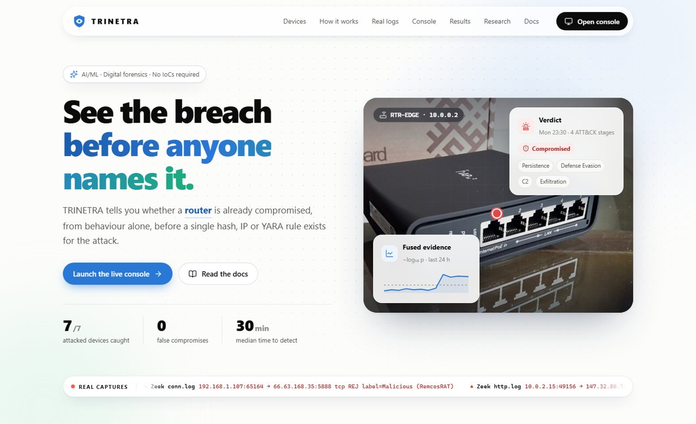

## The problem

Signature tools match **Indicators of Compromise**: file hashes, IP addresses, domains, YARA rules. An IoC exists only after somebody has already analysed the attack, so the first victims see nothing. Modern intrusions make this worse:

- attackers **live off the land** (built-in tools, stolen credentials), so there is no malicious file to match;
- **routers, firewalls and VPN gateways** are the favourite entry point, and they cannot run an endpoint agent;
- every campaign uses **fresh infrastructure**, so yesterday's IP lists do not apply.

TRINETRA answers a different question: *is this device behaving like itself?* It learns how every device normally behaves and decides from behaviour alone whether a system, firewall, router or network segment is compromised.

## How it works

### System context

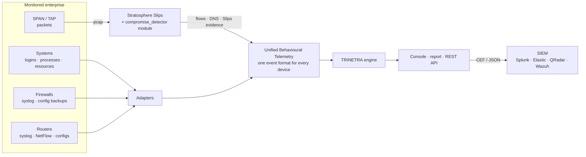

Every source is converted into one event format (**UBT**: `{ts, device, kind, ...}` with kinds `flow, dns, auth, proc, log, config, resource, alert`). Because the engine only sees UBT, one engine covers all four device classes.

### Detection pipeline (every 15 minutes, per device)

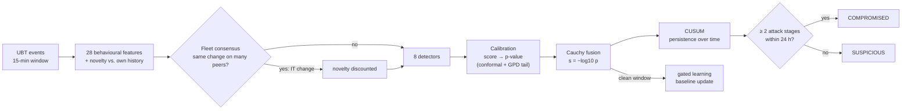

### The eight detectors

| # | Detector | Question it asks | Type |
|---|---|---|---|
| D1 | Robust deviation | How far is this window from the device's own normal (median / MAD)? | statistics |
| D2 | Isolation Forest | Is this behaviour easy to isolate from devices of the same class? | machine learning |
| D3 | Autoencoder | Can a network trained only on normal behaviour rebuild this window? | neural network |
| D4 | Log grammar | How surprising is this order of syslog messages (DeepLog-style)? | sequence model |
| D5 | Beaconing | Is a never-seen external host contacted like clockwork? | periodicity |
| D6 | Graph rarity | Is this a new internal path to a service nobody used before? | graph |
| D7 | Config semantics | What changed in a router / firewall config, by whom, from where, when? | expert rules |
| D8 | Slips evidence | What do Slips' own behavioural detections say? | base IPS |

No single detector decides. Each score becomes a calibrated p-value, the p-values are fused with the Cauchy combination test (robust to correlated detectors), and a CUSUM accumulates evidence so that one noisy window fades while low-and-slow attacks build up.

### Verdict state machine

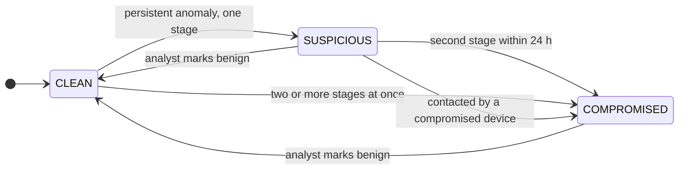

### Eight layers against false alarms

| Layer | Effect |
|---|---|
| Own baseline + time of day | a 2 a.m. backup is normal for the backup server |
| Calibrated p-values | thresholds mean a known false-alarm probability |
| Cauchy fusion | one noisy detector cannot convict alone |
| CUSUM persistence | blips fade, slow attacks accumulate |
| Fleet consensus | the same change on many peers at once is IT work (patch rollout, new SaaS) |
| Change-window context | known admin + maintenance window = planned change |
| Kill-chain corroboration | COMPROMISED needs at least two ATT&CK stages |
| Gated learning + feedback | attacks never enter the baseline; analysts can mark benign |

## Results

Benchmark: a simulated 22-device enterprise (16 systems, 2 firewalls, 3 routers, 1 network sensor), 4 days of baseline and 3 days of test, 414,080 events. Four IoC-free attack campaigns with new random attacker IPs and domains, and six benign traps designed to cause false alarms.

| Metric (seed 7) | Value |
|---|---|
| Attacked devices caught | **7 / 7** (workstation, file server, DB server, edge router, perimeter firewall, DNS-tunnelling host, network sensor) |
| Clean devices wrongly convicted | **0 / 15** |
| Benign traps (patch rollout, planned change, late work, browsing spree, new app, backup surge) | none convicted, 2 shown as SUSPICIOUS for review |
| Median time to detect | **30 min** |

**Ablation** (remove one layer, same data): without fleet consensus 13 clean devices raise alarms and 1 is convicted; without kill-chain corroboration 2 are convicted; without CUSUM 2 attacks are missed. The best single detector either misses an attack or convicts a clean device.

**Other seeds:**

| Seed | Attacks | Caught | Clean devices convicted | Median TTD |
|---|---|---|---|---|
| 11 | all four | 7 / 7 | 0 | 15 min |
| 42 | all four | 7 / 7 | 0 | 15 min |
| 99 | A1 only | 3 / 3 | 0 | 30 min |
| 201 | A2 only | 1 / 1 | 0 | 0 min |
| 303 | A4 only | 2 / 2 | 0 | 345 min |

Full tables and per-device timelines: [12-evaluation.md](trinetra_docs/12-evaluation.md).

> **Limitations.** The benchmark is a simulation we built, because no public dataset combines router and firewall configs, syslog, host telemetry and flows with ground truth. The Slips module follows the v1.1.24 module API but has not yet been run inside a live Slips/Redis instance. Both are on the validation roadmap in the docs.

## Screenshots

**Analyst console:** replay the week, watch verdicts change, open a forensic report for any device.

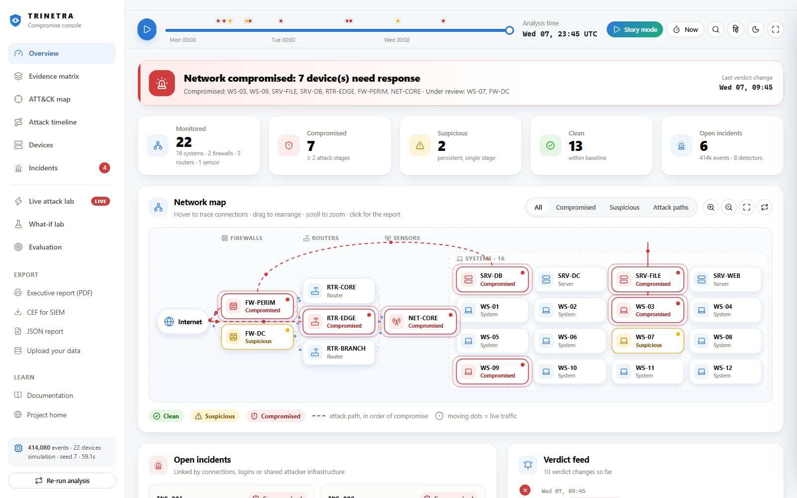

<table>
  <tr>
    <td width="50%">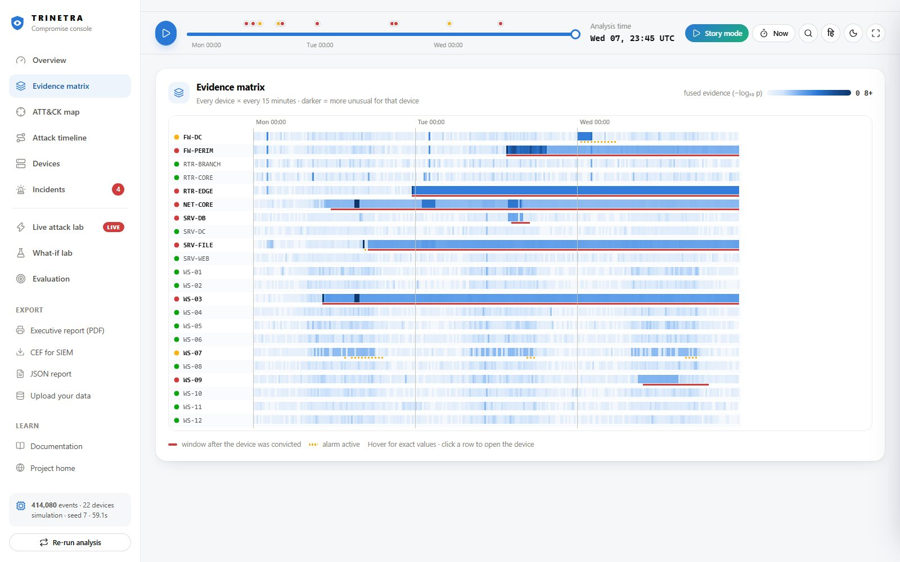<br><b>Evidence matrix</b>: every device × every 15 minutes. Attacks are bright streaks, benign traps only flicker.</td>
    <td width="50%">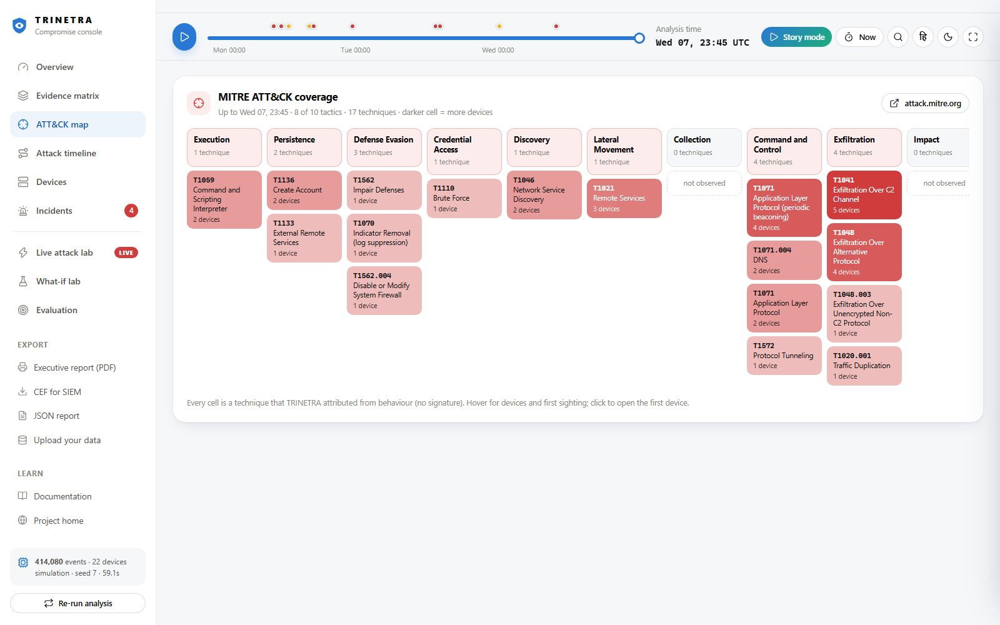<br><b>ATT&CK map</b>: techniques attributed from behaviour, without a single signature.</td>
  </tr>
  <tr>
    <td>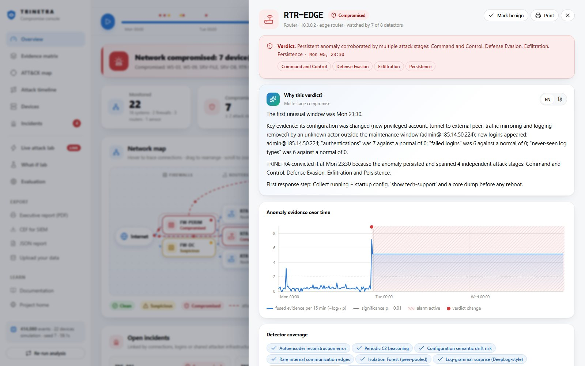<br><b>Forensic report</b>: plain-language reason, evidence chart, detector coverage, playbook.</td>
    <td>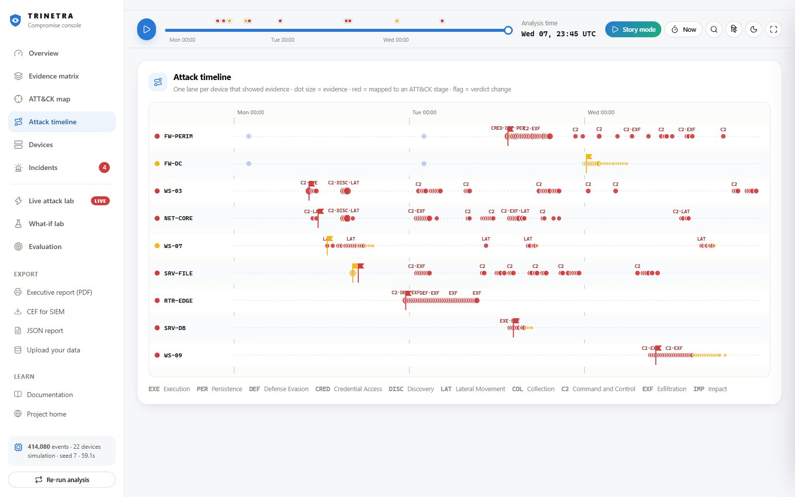<br><b>Attack timeline</b>: one swim-lane per device with ATT&CK stages and verdicts.</td>
  </tr>
  <tr>
    <td>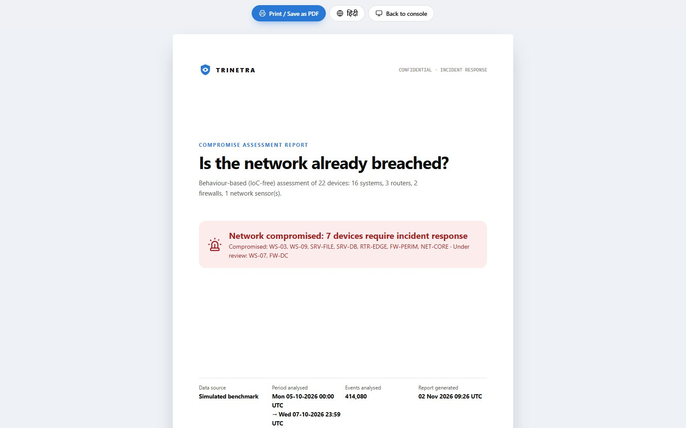<br><b>Executive report</b>: printable compromise assessment (Save as PDF).</td>
    <td>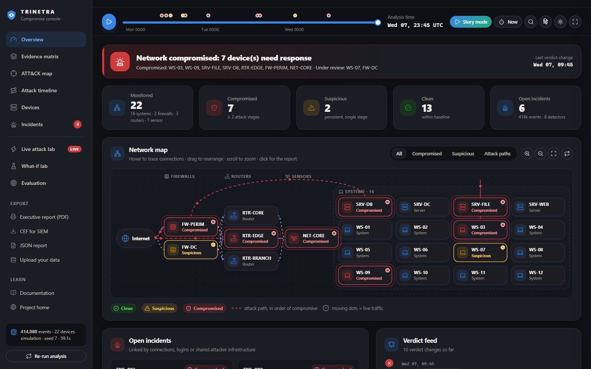<br><b>Dark mode</b>, English / हिंदी, presenter mode.</td>
  </tr>
</table>

Also in the console: **story mode** (narrated walkthrough of the intrusion), **live attack lab** (simulate a fresh week with one attack and stream it window by window), **what-if lab** (change CUSUM parameters or switch layers off and see the effect), data upload, CEF/JSON export, Ctrl+K command palette.

**Real logs on the landing page.** Excerpts from five public captures shipped with Slips (Remcos RAT, Mozi IoT botnet, port scan, telnet scanning, Suricata alerts), with the feature values TRINETRA's own code computes on them:

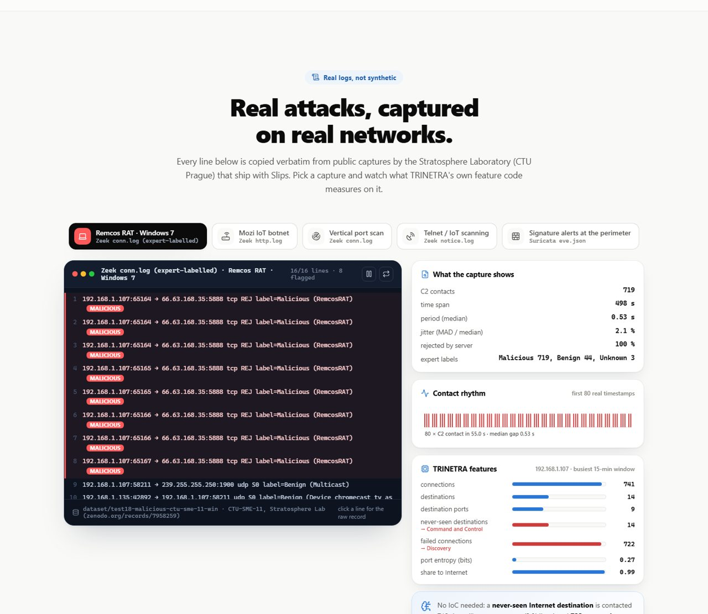

<details>
<summary><b>Device photo section</b> (real photographs, Wikimedia Commons)</summary>


</details>

## Quick start

```bash
git clone https://github.com/ayushkumartht/trinetra-compromise-detector.git
cd trinetra-compromise-detector
pip install -r compromise_dashboard/requirements.txt
python -m compromise_dashboard            # http://127.0.0.1:5050
```

On Windows you can double-click `run_trinetra.bat`. No GPU, cloud or internet connection is needed. The first start analyses the benchmark week (about a minute including the ablation study); later starts load the cached result.

| URL | What you get |
|---|---|
| `/` | Landing page |
| `/console` | Analyst console |
| `/report` | Printable executive report |
| `/docs` | Documentation with rendered diagrams (offline) |

**With live Slips traffic** (Linux, Docker or a Slips installation, see [SLIPS_README.md](SLIPS_README.md)):

```bash
./slips.py -i eth0                                      # the compromise_detector module is auto-loaded
python -m compromise_dashboard --slips-output output/<run>
```

**Other commands**

```bash
python -m compromise_dashboard --rebuild --seed 11      # analyse a different random week
python -m compromise_dashboard.build_real_logs          # regenerate the real-log excerpts
python -m unittest tests.unit.modules.compromise_detector.test_compromise_detector
```

## Repository layout

The repository is Stratosphere Slips v1.1.24 with TRINETRA added in separate folders. The first commit is the unmodified Slips tree; everything after it is TRINETRA.

```text
modules/
  compromise_detector/
    compromise_detector.py      Slips module: streams flows, DNS and evidence as UBT
    core/
      schema.py                 UBT event format and device inventory
      features.py               28 features, novelty profiles, fleet consensus
      detectors.py              8 detectors, tail calibration, Cauchy fusion
      engine.py                 CUSUM, kill-chain corroboration, verdicts, incidents
      pipeline.py               demo / real runs, evaluation, ablation
      adapters.py               Zeek, syslog, config backups, Slips alerts → UBT
      simulate.py               22-device testbed with attacks and benign traps
  supported_module_names.py     registers the module (only changed Slips file)
compromise_dashboard/
  server.py · labs.py           Flask API, labs, uploads, report
  build_real_logs.py            real log excerpts from dataset/
  static/                       landing, console, report, docs (vanilla JS, offline)
tests/unit/modules/compromise_detector/   engine unit tests
trinetra_docs/                  19 documentation pages (Markdown + Mermaid)
SLIPS_README.md                 the original Slips README
```

Details for every file: [04-repository.md](trinetra_docs/04-repository.md).

## Documentation

| | |
|---|---|
| Start here | [Overview](trinetra_docs/00-overview.md) · [Problem](trinetra_docs/01-problem.md) · [Quick start](trinetra_docs/02-quickstart.md) · [Basics se samjho (Hinglish)](trinetra_docs/17-basics-se-samjho.md) |
| Design | [Architecture](trinetra_docs/03-architecture.md) · [Repository tour](trinetra_docs/04-repository.md) · [Slips integration](trinetra_docs/05-slips-integration.md) |
| Engine | [Telemetry](trinetra_docs/06-telemetry.md) · [Features](trinetra_docs/07-features.md) · [Detectors](trinetra_docs/08-detectors.md) · [Fusion & verdict](trinetra_docs/09-fusion-and-verdict.md) · [False alarms](trinetra_docs/10-false-alarms.md) |
| Use | [Console & API](trinetra_docs/11-console-and-api.md) · [Deployment](trinetra_docs/13-deployment.md) · [Presentation guide](trinetra_docs/15-presentation-guide.md) · [Glossary](trinetra_docs/16-glossary.md) |
| Evidence | [Evaluation](trinetra_docs/12-evaluation.md) · [Research basis](trinetra_docs/14-research.md) · [Research survey](trinetra_docs/18-research-survey.md) |

## Research basis

The engine combines published ideas rather than inventing new statistics:

- **Kitsune** (NDSS 2018): autoencoders for unsupervised network anomaly detection → D3
- **DeepLog** (CCS 2017): anomaly detection on log sequences → D4
- **Conformal outlier p-values** (Annals of Statistics 2023) and **SPOT / extreme value theory** (KDD 2017) → calibration
- **Cauchy combination test** (JASA 2020) → fusion of correlated detectors
- **RITA** (Active Countermeasures) → beacon detection; **HyperVision** (NDSS 2023) → graph view of traffic
- **Sommer & Paxson** (IEEE S&P 2010) and **Arp et al.** (USENIX Security 2022) → evaluation and false-alarm design
- **MITRE ATT&CK** → stages and technique IDs; **CISA / ACSC edge-device guidance (2025)** → why routers and firewalls need their own detection

## Credits and licence

- Base project: [Stratosphere Linux IPS (Slips)](https://github.com/stratosphereips/StratosphereLinuxIPS), Stratosphere Laboratory, CTU Prague, GPL-2.0. The real log captures under `dataset/` come with Slips.
- Icons: [Lucide](https://lucide.dev) (ISC) and [Simple Icons](https://simpleicons.org) (CC0). Docs rendering: marked (MIT), mermaid (MIT).
- Photographs: Wikimedia Commons contributors under CC0 / CC BY / CC BY-SA; authors and licences in [`credits.json`](compromise_dashboard/static/img/photos/credits.json).

TRINETRA is released under the **GPL-2.0**, the same licence as Slips. See [LICENSE](LICENSE).
