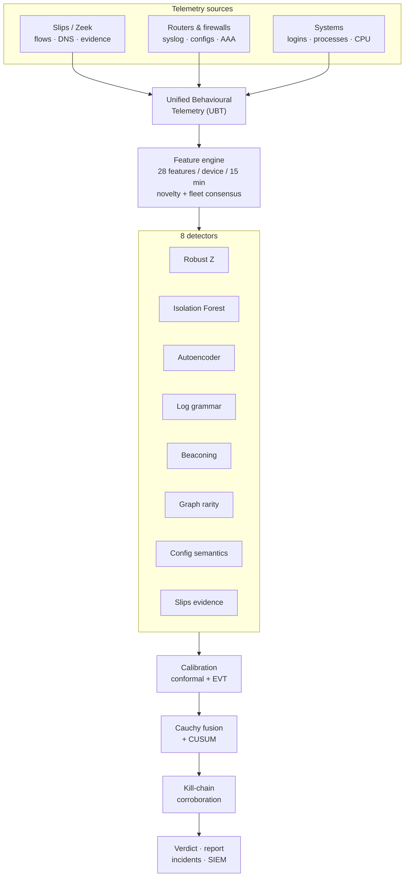

<!-- group: Start here -->
# TRINETRA: overview

TRINETRA is an AI/ML tool that decides whether a <strong>system, firewall, router or network is compromised</strong>, without relying on Indicators of Compromise (IoCs). It extends the open-source behavioural IPS <strong>Stratosphere Slips</strong>.

> **One-line thesis:** a compromised device behaves differently from its own past, from its peers, and from what the network observes about it. Measure all three, calibrate them statistically, and declare compromise only when independent evidence agrees.

## The 60-second version

| Question | Answer |
|---|---|
| What problem? | Detect compromise of any compute device **when no IoC is known yet** (zero-days, living-off-the-land, edge-device implants). |
| What input? | Network flows and DNS (from Slips/Zeek), Slips evidence, router/firewall syslog and configs, host logins/processes/resources. |
| What output? | Per device: **CLEAN / SUSPICIOUS / COMPROMISED**, with explanation, MITRE ATT&CK stages, forensic actions, linked incidents, SIEM export. |
| How? | 28 behavioural features every 15 minutes → **8 detectors** → calibrated p-values → **Cauchy fusion** → **CUSUM** persistence → **kill-chain corroboration** → verdict. |
| Why trust it? | On a 22-device benchmark with 4 IoC-free attack campaigns and 6 benign traps: **7/7 attacked devices caught, 0/15 clean devices wrongly convicted**, median time-to-detect 30 min. |
| How to run? | `python -m compromise_dashboard` → landing page, console and these docs at `http://127.0.0.1:5050`. |

## Architecture at a glance

## How these docs are organised

| Section | Pages | Read it when you want to… |
|---|---|---|
| **Start here** | Overview · Problem · Quick start | understand what and why, and run the demo |
| **Architecture** | Architecture · Repository tour · Slips integration | explain the code base and how the pieces connect |
| **Engine** | Telemetry · Features · Detectors · Fusion & verdict · False alarms | explain *how* detection works, including the maths |
| **Interface** | Console & API | walk through every screen and endpoint |
| **Evaluation** | Evaluation | show results, ablations and limitations |
| **Operations** | Deployment | deploy on real networks |
| **Research** | Research background | position the work against the literature |
| **Presenting** | Presentation guide | run the demo for judges and answer their questions |
| **Reference** | Glossary | look up a term |

## Mapping to the evaluation criteria

| Criterion | Where TRINETRA answers it | Docs |
|---|---|---|
| **(a) Innovation & ruggedness** | Unified telemetry for 4 device classes; config-semantic drift; conformal + EVT calibrated Cauchy fusion; kill-chain corroboration; fleet consensus; gated anti-poisoning learning | [Detectors](08-detectors.md), [Fusion](09-fusion-and-verdict.md) |
| **(b) Utility across devices** | One engine for system / firewall / router / network; all four are attacked and detected in the benchmark | [Telemetry](06-telemetry.md), [Evaluation](12-evaluation.md) |
| **(c) Deployment & reporting** | Agentless inputs, single `pip` install, Slips module, console with forensic reports, CEF/JSON export | [Deployment](13-deployment.md), [Console & API](11-console-and-api.md) |
| **(d) Minimising false alarms** | 8 stacked false-alarm layers, ablation evidence, benign traps stay clean | [False alarms](10-false-alarms.md) |

## Key numbers (benchmark, seed 7)

| Metric | Value |
|---|---|
| Devices | 22 (12 workstations, 4 servers, 3 routers, 2 firewalls, 1 network sensor) |
| Events analysed | 414,080 over 7 days (4 baseline + 3 test) |
| Recall / precision / F1 | 1.00 / 1.00 / 1.00 at device level |
| False compromises | 0 of 15 clean devices |
| Clean devices reaching SUSPICIOUS | 2 (a user starting a new DB app; a backup surge), both visible for analyst review |
| Median time to detect | 30 minutes from the first compromising action |
| Runtime | ≈ 3 minutes on a laptop CPU including the ablation study (≈ 30 s without) |
