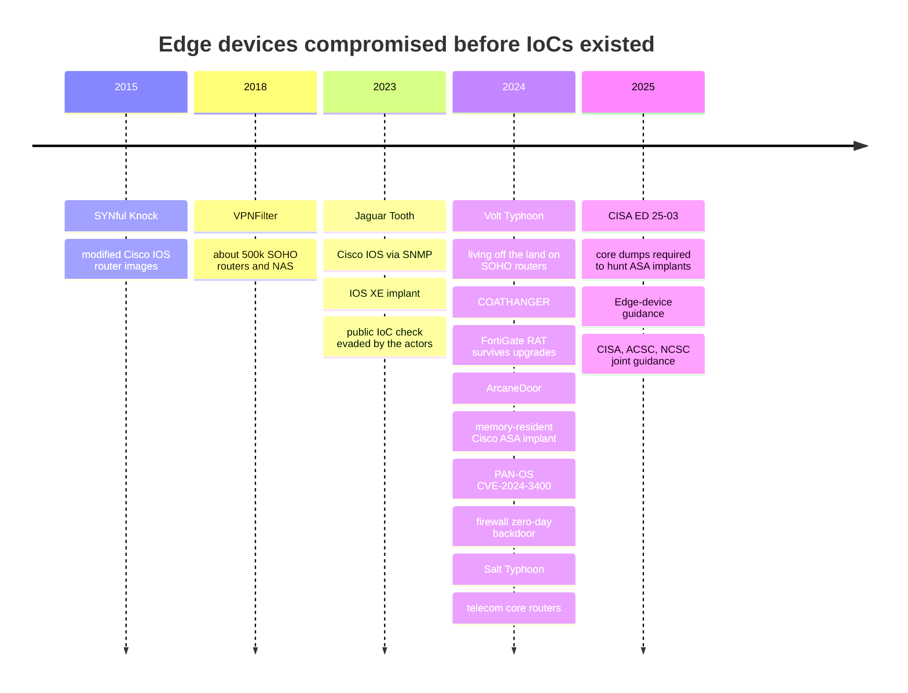
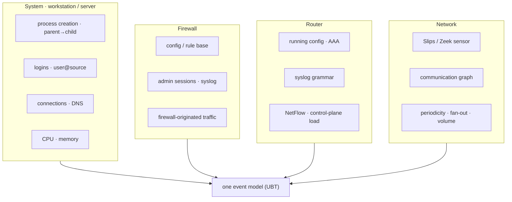

<!-- group: Start here -->
# The problem

> *Develop an AI/ML tool to detect whether a system / firewall / router / network is compromised. The technique should not rely only on IoCs. Evaluation: (a) innovation and ruggedness of the method, (b) utility over various types of devices, (c) ease of deployment and method of reporting, (d) ability to minimise false alarms.*

Domain: **Digital Forensics**.

## Decoding the statement

| Phrase | What it really means | Design consequence |
|---|---|---|
| "not rely only on IoCs" | Detect **unknown** compromise: no hash, IP, domain or YARA rule exists yet | Learn *normal behaviour* and detect *deviation*; IoCs can be an extra signal, never the only one |
| "system / firewall / router / network" | Four device classes with very different telemetry | A **common data model** so one engine covers all of them |
| "early detection" | Catch C2, discovery and lateral movement, not the ransom note | Streaming 15-minute windows; kill-chain-aware correlation |
| "critical information infrastructure" | Legacy systems, many appliances, no tolerance for noise | Agentless inputs; extremely low false-alarm rate |
| "method of reporting" | How does an operator learn *and act*? | Verdict levels, explanation, ATT&CK mapping, forensic playbook, SIEM export |

## Why IoCs are not enough

An IoC is a fingerprint of a *known* attack. It has three structural weaknesses:

1. **Latency.** It exists only after someone has analysed the attack, typically days to weeks after initial access.
2. **Cheap evasion.** Attackers rotate IPs and domains and recompile binaries at almost no cost.
3. **Nothing to match.** Living-off-the-land (LOTL) attacks use built-in tools and valid accounts, so there is no malicious file at all.

Network appliances make this worse: routers and firewalls **cannot run EDR agents**, and their implants often live in memory or in the boot chain.

## What compromise looks like without an IoC

The attacker's tools are unknown, but their **effects** are observable. Whatever the malware, an intruder must:

| Must… | Observable behaviour | ATT&CK tactic |
|---|---|---|
| talk to its operator | periodic connections to never-seen destinations; high-entropy DNS | Command and Control |
| stay | new accounts, rules, tunnels, services, process chains | Persistence |
| hide | logging disabled or removed, log volume drop | Defense Evasion |
| look around | fan-out to many internal hosts, failed connections | Discovery |
| obtain credentials | bursts of failed logins | Credential Access |
| move | new internal edges to services nobody used, new user@source logins | Lateral Movement |
| take data | upload volume and asymmetry to the Internet, DNS sub-domain explosion, traffic mirroring | Exfiltration |

TRINETRA turns each of these into a measurable feature or a dedicated detector.

## Device classes and their telemetry

## Threat model

| In scope | Out of scope (stated honestly) |
|---|---|
| Unknown malware and implants on hosts, routers and firewalls | A device already compromised *before* baselining with perfectly stable behaviour (mitigated by peer comparison and onboarding integrity checks) |
| Living-off-the-land with valid credentials | Firmware implants that perfectly mimic all behaviour and logs (hand-off to memory forensics, triggered by SUSPICIOUS) |
| Night-time and low-and-slow activity | Attacks fully contained inside encrypted payloads with no metadata change |
| Log tampering (logging removed / volume drop) | Compromise of the TRINETRA collector itself (runs off-device, read-only credentials) |

## Success criteria we set ourselves

- **Recall:** every attacked device in the benchmark convicted (COMPROMISED).
- **Precision:** no clean device convicted; benign changes (patch, planned change, late work, new app, browsing spree, backup surge) must not convict.
- **Explainability:** every verdict carries the behaviours that changed, the detectors that fired and the ATT&CK stages.
- **Deployability:** runs on a laptop CPU, no GPU, no cloud, and also as a Slips module.
