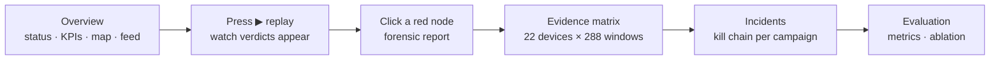

<!-- group: Start here -->
# Quick start

## Requirements

| Item | Version |
|---|---|
| Python | 3.10+ (tested on 3.13) |
| Packages | `flask numpy scipy scikit-learn` |
| OS | Windows, Linux or macOS for the console and engine; Linux or Docker for live Slips |
| Hardware | any laptop CPU; no GPU |

## Run the demo (Windows / Linux / macOS)

```bash
cd slips
pip install -r compromise_dashboard/requirements.txt
python -m compromise_dashboard
```

On Windows you can double-click **`run_trinetra.bat`** instead. It installs the packages, opens the browser and starts the server.

Open **http://127.0.0.1:5050**:

| URL | What |
|---|---|
| `/` | Landing page: the story, live replay, results |
| `/console` | Analyst console |
| `/docs` | This documentation |

The first start analyses a simulated 7-day enterprise (≈ 3 minutes including the ablation study). A progress screen shows each stage. Later starts load the cached result from `compromise_dashboard/data/results.json` instantly.

## Command-line options

```bash
python -m compromise_dashboard                     # demo, cached if available
python -m compromise_dashboard --rebuild --seed 11 # fresh simulated week
python -m compromise_dashboard --port 8080 --host 0.0.0.0
python -m compromise_dashboard --slips-output output/<run>   # real Slips telemetry
```

## Five-minute tour of the console



1. **Overview.** At "now" the status bar is inverted white: *Network compromised: 7 devices*. The map shows attack paths as moving dashed lines.
2. **Replay.** Press **▶** (or the space bar). The timeline ticks mark every verdict change; click a tick to jump to it.
3. **Forensic report.** Click `RTR-EDGE`. You see the night-time login from an unknown Internet address, the config diff (new user, GRE tunnel, ERSPAN mirror, logging removed), the evidence chart and the router-specific response steps.
4. **Evidence matrix.** Every device × every 15 minutes as brightness. Attack campaigns appear as bright streaks.
5. **Incidents.** Four critical incidents, one per campaign, each with its ATT&CK stage strip and chronological kill chain.
6. **Evaluation.** Precision, recall, time to detect, scenario outcomes and the ablation table.

## Run the engine without the UI

```python
from modules.compromise_detector.core.pipeline import run_demo
r = run_demo(seed=7, ablations=False)
print(r["evaluation"]["precision"], r["evaluation"]["recall"])
for d in r["devices"]:
    print(d["id"], d["verdict"], d["tactics"])
```

## Troubleshooting

| Symptom | Fix |
|---|---|
| `ModuleNotFoundError: modules` | Run commands from inside the `slips/` folder |
| Port 5050 in use | `--port 5051` |
| Progress screen stays at 0 % | Check the terminal for a Python error; `pip install -U scikit-learn scipy` |
| Docs show "loading…" | Hard-refresh; the docs need `static/vendor/mermaid.min.js` (bundled) |
