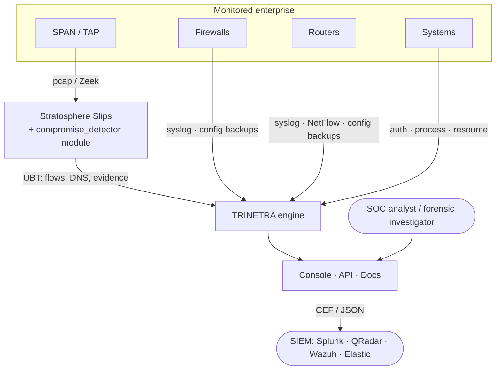
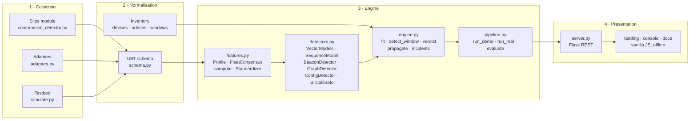
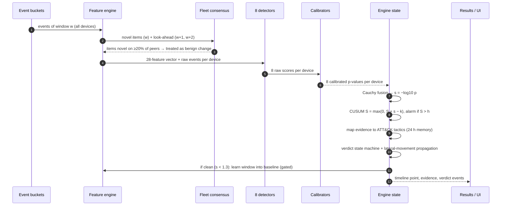
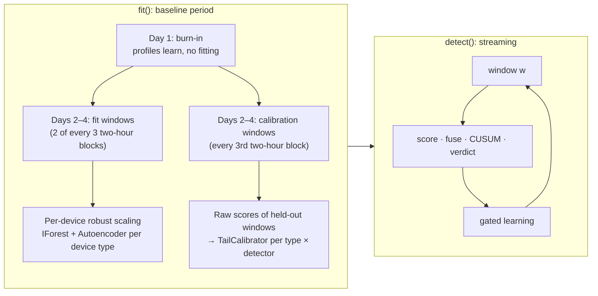
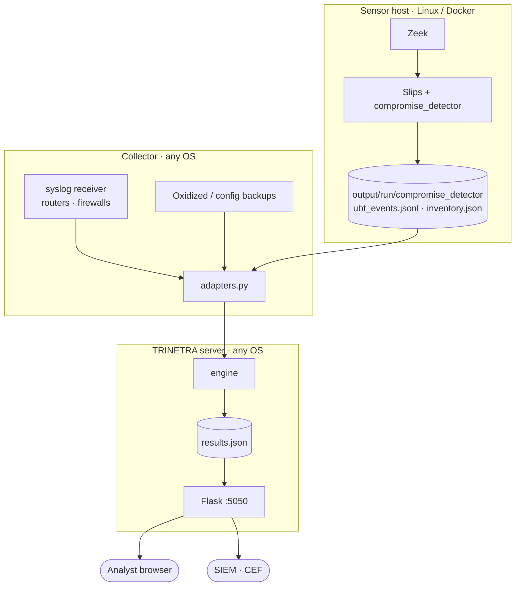

<!-- group: Architecture -->
# System architecture

TRINETRA has four layers: **collection**, **normalisation**, **detection engine** and **presentation**. Each layer talks to the next through one stable contract.

## Context

## Components

| Layer | Contract it produces | Why it matters |
|---|---|---|
| Collection | UBT JSON lines `{ts, device, kind, ...attrs}` | Any new data source only needs a small adapter |
| Normalisation | `Event` objects + `Inventory` | The engine never sees vendor formats |
| Engine | `results` dict: devices, timeline, evidence, verdict events, incidents | One object drives UI, CEF and JSON export |
| Presentation | REST + static pages | Works offline, no build step, no CDN |

## Life of one 15-minute window

## Training vs detection

Calibration windows are **interleaved** with fitting windows across weekdays, weekends, days and nights. That way the calibrated p-values reflect every normal regime, not a single quiet day.

## Deployment view

## Design principles

1. **Device-agnostic core.** All four device classes share the same feature vector; missing telemetry is simply zero, and the coverage is shown per device.
2. **Calibrate everything.** No detector is trusted with a hand-picked threshold; each one gets a data-driven p-value.
3. **Convict on corroboration.** Statistics raise SUSPICIOUS; independent attack stages are required for COMPROMISED.
4. **Explain every verdict.** Evidence records what changed, by how much versus normal, and which detector saw it.
5. **Ship anywhere.** Pure Python + numpy/scipy/scikit-learn; front-end is vanilla JS with vendored libraries; no GPU, no cloud.
