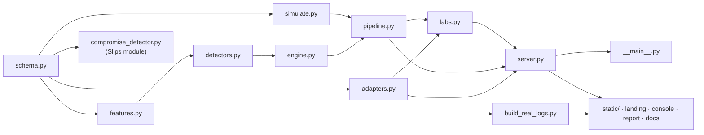

<!-- group: Architecture -->
# Repository tour

The project is a **fork of Stratosphere Slips v1.1.24** (GPL-2.0). Everything TRINETRA adds lives in clearly separated folders, so the original Slips code keeps working.

## What we added (and the one file we changed)

```text
slips/
├── modules/
│   ├── compromise_detector/                ← NEW · Slips module + engine
│   │   ├── compromise_detector.py          ← Slips IModule: streams flows/DNS/evidence as UBT
│   │   └── core/                           ← detection engine (pure Python)
│   │       ├── schema.py                   ← Unified Behavioural Telemetry, Inventory
│   │       ├── features.py                 ← 28 features, novelty Profile, FleetConsensus, Standardizer
│   │       ├── detectors.py                ← 8 detectors, TailCalibrator, Cauchy combination
│   │       ├── engine.py                   ← fit / detect / CUSUM / kill chain / verdict / incidents
│   │       ├── pipeline.py                 ← run_demo, run_real, evaluate, ablations, playbooks
│   │       ├── adapters.py                 ← Slips alerts, Zeek, syslog, config backups → UBT
│   │       └── simulate.py                 ← 22-device testbed, 4 attacks, 6 benign traps
│   └── supported_module_names.py           ← CHANGED · registers "compromise_detector"
├── compromise_dashboard/                   ← NEW · web application
│   ├── __main__.py                         ← CLI: python -m compromise_dashboard
│   ├── server.py                           ← Flask app: pages, results API, exports, docs serving
│   ├── labs.py                             ← what-if lab, live attack lab, uploads, sample data, /report
│   ├── build_real_logs.py                  ← extracts real log excerpts from dataset/ for the landing page
│   ├── requirements.txt                    ← flask, numpy, scipy, scikit-learn
│   ├── data/results.json                   ← cached benchmark analysis (generated)
│   └── static/
│       ├── landing.html  console.html  docs.html  report.html
│       ├── css/  core.css · landing.css · console.css · docs.css
│       ├── js/   landing.js · console.js · extras.js · explain.js · i18n.js · theme.js · report.js · docs.js
│       ├── data/real_logs.json             ← output of build_real_logs.py
│       ├── img/  icons.svg · photos/ (Wikimedia Commons, credits.json) · shots/ (console screenshots)
│       └── vendor/  marked.umd.js · mermaid.min.js (offline docs rendering)
├── tests/unit/modules/compromise_detector/ ← NEW · engine unit tests
├── trinetra_docs/                          ← NEW · this documentation (Markdown + Mermaid)
├── README.md                               ← NEW · project README (TRINETRA)
├── SLIPS_README.md                         ← the original Slips README, renamed
└── run_trinetra.bat                        ← NEW · Windows launcher
```

Apart from renaming Slips' README to `SLIPS_README.md`, nothing else in the Slips tree was touched. The first commit of the repository is the unmodified Slips v1.1.24 tree, so `git diff <first commit> HEAD --stat` lists exactly these paths.

## How the files depend on each other



## File-by-file responsibilities

| File | Key classes / functions | Responsibility |
|---|---|---|
| `schema.py` | `Event`, `Device`, `Inventory`, `is_internal`, `read_events` | The data contract. Defines the 8 event kinds and the 4 device types |
| `features.py` | `FEATURES`, `Profile`, `window_items`, `FleetConsensus`, `compute`, `Standardizer`, `FEATURE_ATTACK` | Turns raw events into 28 behavioural numbers; tracks what each device has seen; maps features to ATT&CK |
| `detectors.py` | `VectorModels`, `SequenceModel`, `BeaconDetector`, `GraphDetector`, `ConfigDetector`, `slips_score`, `TailCalibrator`, `cauchy_combine` | The 8 detectors and the statistics that make them comparable |
| `engine.py` | `Engine.fit`, `Engine.detect_window`, `_verdict`, `_propagate`, `_explain`, `incidents`, `results` | Orchestration, fusion, persistence, verdict state machine, explanations, incident correlation |
| `pipeline.py` | `run_demo`, `run_real`, `evaluate`, `RECOMMENDED_ACTIONS` | End-to-end runs, metrics, ablation study, per-device-type forensic playbooks |
| `adapters.py` | `TemplateMiner`, `read_zeek`, `read_syslog`, `read_config_snapshots`, `read_slips_alerts`, `load_slips_export` | Real-world ingestion |
| `simulate.py` | `Simulator`, `SCENARIOS` | Ground-truth testbed (see [Evaluation](12-evaluation.md)) |
| `compromise_detector.py` | `CompromiseDetector(IModule)` | Live bridge from Slips' Redis channels to UBT |
| `server.py` | Flask routes, `start_job`, `save_results` | API, background analysis, analyst feedback, exports, docs serving |
| `labs.py` | `labs` blueprint, `prewarm`, live worker | What-if and live labs, data upload, sample download, executive report |
| `build_real_logs.py` | `remcos`, `mozi`, `port_scan`, `engine_features` | Copies real capture excerpts and runs `features.compute` on them |
| `console.js` | topology, matrix, drawer, chart, evaluation | The analyst console |
| `extras.js` | story mode, labs, ATT&CK map, palette, toasts | Console features added on top of `console.js` hooks |
| `explain.js` · `i18n.js` · `theme.js` | `explainDevice`, `tr`, `toggleTheme` | Plain-language "why", English/हिंदी, light/dark |
| `landing.js` | photo grid, real-log viewer, console showcase, live numbers | The landing page |
| `docs.js` | marked + mermaid rendering, search, scroll-spy | The documentation site |

## Tests

```bash
python -m unittest tests.unit.modules.compromise_detector.test_compromise_detector      # ~25 s
TRINETRA_SLOW=1 python -m unittest tests.unit.modules.compromise_detector.test_compromise_detector   # + full benchmark
```

They cover the event schema, feature counts, novelty, fleet consensus and the patch-rollout check, tail calibration, Cauchy fusion, the beacon detector, simulator ground truth and (slow) the seed-7 benchmark. They use plain `unittest`, so they run without Slips' Redis-based pytest fixtures.

## The original Slips code base (what we build on)

| Slips folder | Role |
|---|---|
| `slips.py` | Entry point |
| `managers/` | Process manager, module loading (`module_loading_mixin.py` discovers `modules/<name>/<name>.py`) |
| `slips_files/core/` | Input process, profiler, evidence handler, database (Redis) |
| `slips_files/common/abstracts/imodule.py` | `IModule` base class every detection module extends |
| `modules/` | ~30 detection modules (flow alerts, threat intelligence, ML models, RNN C&C, HTTP analyzer…) |
| `webinterface/`, `kalipso.sh` | Slips' own web UI and terminal UI |
| `dataset/` | Small test captures used by Slips' tests |
| `docs/` | Slips' ReadTheDocs documentation |

> **Why a sub-package?** Slips loads only files whose name equals their folder (`modules/x/x.py`). Our engine lives in `modules/compromise_detector/core/`, so Slips never tries to start it as a module, but the bridge module can import it.

## Size

| Area | Lines |
|---|---|
| Engine + Slips module (`modules/compromise_detector/**/*.py`) | ≈ 1,800 |
| Web application, Python (`compromise_dashboard/*.py`) | ≈ 620 |
| Web application, front end (HTML, CSS, JS, excluding vendored libraries) | ≈ 3,700 |
| Unit tests | ≈ 120 |
| Documentation (`trinetra_docs/`) | 19 pages with Mermaid diagrams |
