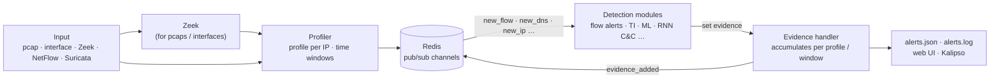
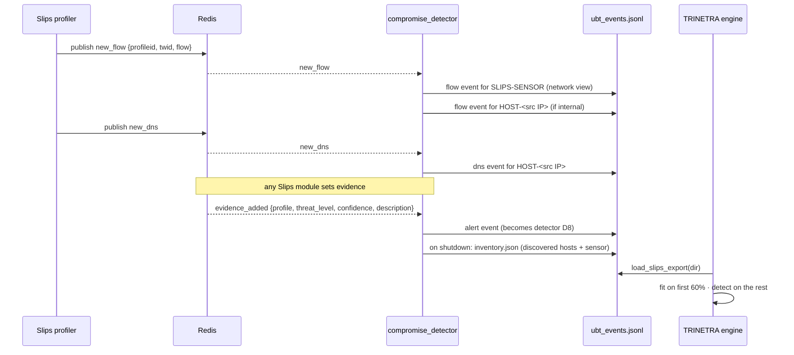

<!-- group: Architecture -->
# Slips integration

## What Slips is

[Stratosphere Linux IPS (Slips)](https://github.com/stratosphereips/StratosphereLinuxIPS) is a behavioural, machine-learning-based network intrusion prevention system from the Stratosphere Laboratory at the Czech Technical University in Prague. It reads pcaps, live interfaces, Zeek logs, NetFlow (nfdump/Argus) or Suricata output, builds a **profile per IP address per time window**, runs ~30 detection modules and raises alerts.



## What Slips does not answer, and TRINETRA adds

| Slips (network IPS) | TRINETRA extension |
|---|---|
| Profiles **IP addresses** seen on the wire | Profiles **devices**: systems, firewalls, routers and the network itself |
| Network flows only | + router/firewall syslog grammar, configuration semantics, host logins and process chains |
| Per-module evidence with threat levels | Calibrated p-values for 8 detectors, **Cauchy fusion**, **CUSUM** |
| Alert when accumulated threat crosses a threshold | **Kill-chain corroboration** (≥ 2 ATT&CK stages) and lateral-movement propagation |
| Alerts per IP | **Device verdicts**, linked **incidents**, forensic playbooks per device type, SIEM CEF |

Slips' evidence is not discarded: it becomes TRINETRA's **8th detector** (`slips`), weighted by severity × confidence and calibrated like the others.

## The bridge module

`modules/compromise_detector/compromise_detector.py` is a regular Slips module (`IModule`). It follows Slips' module conventions: a folder name equal to the file name, `subscribe_to_channels`, `pre_main`, `main`, `shutdown_gracefully`, and registration in `supported_module_names.py`.



### Channel → UBT mapping

| Slips channel | Slips object | UBT event | Device |
|---|---|---|---|
| `new_flow` | `flow.starttime, saddr, daddr, dport, proto, sbytes, dbytes, dur` | `flow {src, dst, dport, proto, bout, bin, dur}` | `SLIPS-SENSOR` and `HOST-<saddr>` for internal sources |
| `new_dns` | `flow.query` | `dns {q}` | `HOST-<saddr>` |
| `evidence_added` | `profile.ip, threat_level, confidence, description` | `alert {severity, confidence, description}` | `HOST-<ip>` |

### Enabling it

The module is discovered automatically because it is registered in `modules/supported_module_names.py` (`COMPROMISE_DETECTOR = "compromise_detector"`). To disable it, add `compromise_detector` to `disable` in `config/slips.yaml`, as for any Slips module.

```bash
# Linux / Docker
./slips.py -f capture.pcap          # or: ./slips.py -i eth0
ls output/<run>/compromise_detector/
#   ubt_events.jsonl   inventory.json
python -m compromise_dashboard --slips-output output/<run>
```

> **Status:** the module was written against the Slips v1.1.24 module API but has not yet been executed inside a live Slips + Redis instance. The development machine was Windows without Docker. The engine and console are fully tested on the simulated benchmark.

## Merging router and firewall telemetry

Network appliances usually report to a syslog server and are backed up by tools like Oxidized/RANCID. The adapters turn those files into UBT events for the same engine:

```python
from modules.compromise_detector.core.adapters import (
    load_slips_export, read_syslog, read_config_snapshots, read_zeek)
from modules.compromise_detector.core.pipeline import run_real

events, inv = load_slips_export("output/run1/compromise_detector")
events += read_syslog("/var/log/net/rtr-edge.log", "RTR-EDGE")
events += read_config_snapshots("/backups/oxidized/rtr-edge/", "RTR-EDGE")
events.sort(key=lambda e: e.ts)
# add RTR-EDGE (type "router") to inv.devices, then:
result = run_real(events, inv, train_end=events[0].ts + 7 * 86400)
```

## Licensing

Slips is **GPL-2.0-only**. TRINETRA's files carry `SPDX-License-Identifier: GPL-2.0-only`, so the combined work remains GPL-2.0 and must be distributed with source. Vendored front-end libraries (marked, mermaid) are MIT-licensed; their licences are in `static/vendor/`.
