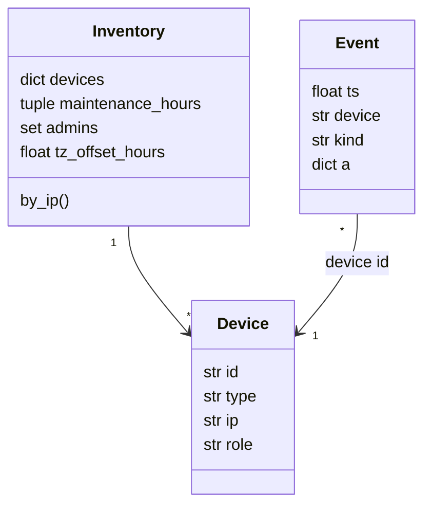
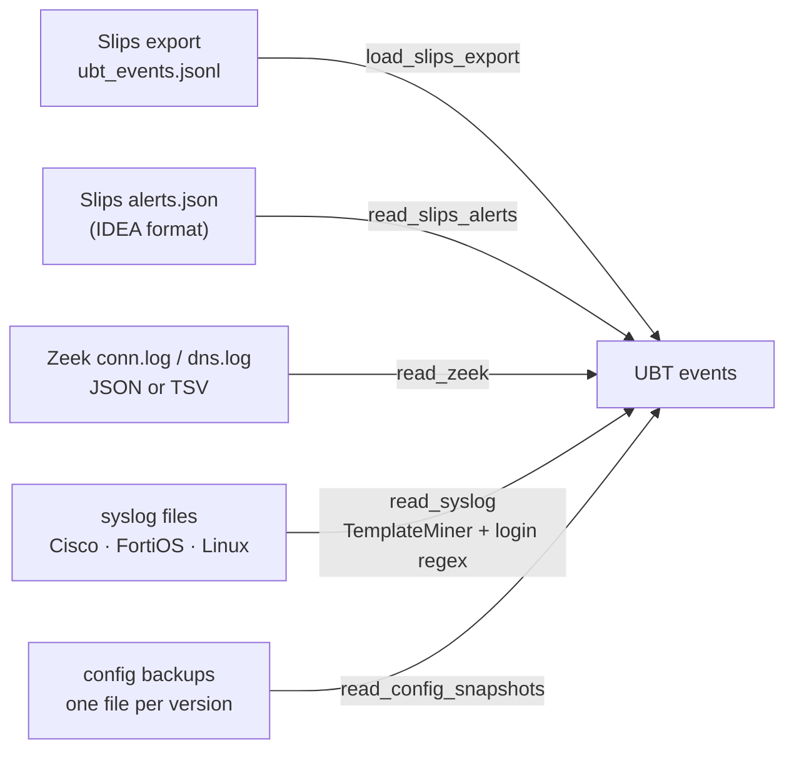

<!-- group: Engine -->
# Unified Behavioural Telemetry

The key to covering four device classes with one engine is a **single event model**. A laptop, a perimeter firewall, a core router and a SPAN sensor all emit the same eight event kinds; a kind a device never produces simply stays empty.

## Event model

Every event is one JSON line:

```json
{"ts": 1791195300.0, "device": "RTR-EDGE", "kind": "config", "text": "hostname RTR-EDGE\n...", "user": "admin", "src": "212.221.199.156"}
```

| Kind | Attributes | Typical sources | Produced by |
|---|---|---|---|
| `flow` | `src, dst, dport, proto, bout, bin, dur` | Slips `new_flow`, Zeek `conn.log`, NetFlow/IPFIX | all four classes |
| `dns` | `q` | Slips `new_dns`, Zeek `dns.log`, resolver logs | systems, sensors |
| `auth` | `user, src, ok` | sshd, Windows 4624/4625, AAA/TACACS, firewall admin logs | all |
| `proc` | `name, parent, user` | Sysmon EID 1, auditd `execve`, osquery `processes` | systems |
| `log` | `t` (template id) | any syslog, mined by `TemplateMiner` | all |
| `config` | `text, user, src` | Oxidized/RANCID backups, `show running-config`, firewall policy export | routers, firewalls |
| `resource` | `cpu, mem` | SNMP, node exporters, WMI | all |
| `alert` | `severity, confidence, description` | Slips `evidence_added`, Slips `alerts.json` | systems, sensors |



## Device types

| Type | Meaning | Detectors that apply |
|---|---|---|
| `host` | workstation or server | robust-Z, IForest, AE, log grammar, beacon, graph, Slips |
| `firewall` | any stateful firewall / NGFW / VPN gateway | robust-Z, IForest, AE, log grammar, beacon, graph, **config** |
| `router` | router, L3 switch | robust-Z, IForest, AE, log grammar, beacon, graph, **config** |
| `network` | passive sensor (Slips/Zeek on SPAN/TAP) | robust-Z, IForest, AE, beacon, graph, Slips |

## Inventory

```json
{
  "devices": [
    {"id": "RTR-EDGE", "type": "router", "ip": "10.0.0.2", "role": "edge router"},
    {"id": "FW-PERIM", "type": "firewall", "ip": "10.0.0.254", "role": "perimeter firewall"},
    {"id": "SLIPS-SENSOR", "type": "network", "ip": "", "role": "Slips sensor"}
  ],
  "maintenance_hours": [1, 3],
  "admins": [["netadmin", "10.0.3.20"]],
  "tz_offset_hours": 5.5
}
```

`maintenance_hours` and `admins` provide **change-management context** for the configuration detector. A change by a known admin inside the window is treated very differently from one by an unknown actor at 23:40.

## Adapters



### Template mining (Drain-lite)

Syslog lines are converted into **template ids** by masking variable tokens (IP:port, MAC, hex, quoted strings, numbers) and keeping the first 12 tokens:

```text
Oct 30 23:40:01 rtr-edge sshd[311]: Failed password for admin from 185.4.4.4 port 5522 ssh2
→ T0000: sshd[<NUM>]: Failed password for admin from <IP> port <NUM>
```

The same line also yields an `auth` event `{user: admin, src: 185.4.4.4, ok: false}`. Login extraction understands OpenSSH, Cisco `LOGIN_SUCCESS/LOGIN_FAILED` and FortiOS `user=… srcip=… status=failed` formats.

## Why "device" and not "IP"?

Slips profiles IP addresses. TRINETRA needs **devices**: a router has several interfaces, a firewall's own management traffic matters more than the traffic it forwards, and a host's logins and processes have no IP at all. The inventory binds identities to device ids, and `Inventory.by_ip()` translates addresses back when relating evidence across devices.
