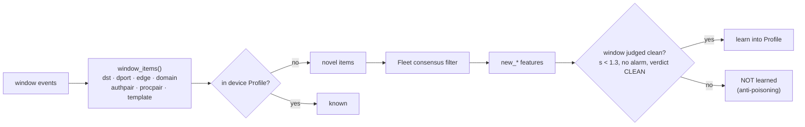
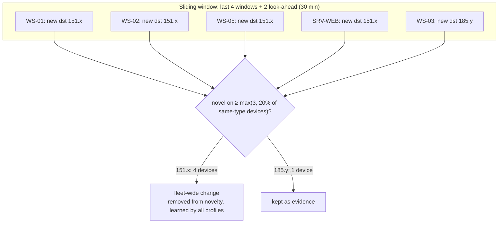

<!-- group: Engine -->
# Behavioural features

Every **15 minutes** (`WINDOW = 900 s`) each device is summarised by **28 behavioural features** plus **3 time-context features**. The same vector is used for every device class.

## The 28 features

| # | Feature | Meaning | Transform | Linked tactic (when abnormally high) |
|---|---|---|---|---|
| 1 | `n_flows` | connections started | log1p | – |
| 2 | `bytes_out` | bytes sent (all) | log1p | – |
| 3 | `bytes_in` | bytes received | log1p | – |
| 4 | `ext_bytes_out` | bytes sent **to the Internet** | log1p | Exfiltration · T1041 |
| 5 | `out_in_ratio` | log upload/download ratio to the Internet | raw | Exfiltration · T1048 |
| 6 | `n_dst` | distinct destinations | log1p | – |
| 7 | `n_dport` | distinct destination ports | log1p | – |
| 8 | `dst_entropy` | Shannon entropy of destinations | raw | – |
| 9 | `dport_entropy` | Shannon entropy of ports | raw | – |
| 10 | `new_dst` | never-seen destinations | log1p | Command and Control · T1071 |
| 11 | `new_dport` | never-seen ports | log1p | Discovery · T1046 |
| 12 | `new_int_edges` | never-seen internal (src, dst, port) edges | log1p | Lateral Movement · T1021 |
| 13 | `int_fanout` | internal hosts contacted | log1p | Discovery · T1046 |
| 14 | `ext_frac` | share of flows to the Internet | raw | – |
| 15 | `failed_conn` | TCP flows with no response | log1p | Discovery · T1046 |
| 16 | `n_dns` | DNS queries | log1p | – |
| 17 | `dns_entropy` | randomness of the sub-domain part (top-3 mean) | raw | Command and Control · T1071.004 |
| 18 | `dns_new_domains` | never-seen registered domains | log1p | Command and Control · T1568 |
| 19 | `dns_max_sub` | unique sub-domains under one domain | log1p | Exfiltration · T1048.003 |
| 20 | `n_auth` | authentications | log1p | – |
| 21 | `auth_fail` | failed authentications | log1p | Credential Access · T1110 |
| 22 | `auth_new_pairs` | never-seen user@source logins | log1p | Lateral Movement · T1078 |
| 23 | `n_proc` | processes started | log1p | – |
| 24 | `new_proc_pairs` | never-seen parent→child process chains | log1p | Execution · T1059 |
| 25 | `n_logs` | log messages | log1p | **drop** → Defense Evasion · T1070 |
| 26 | `new_templates` | never-seen log message types | log1p | – |
| 27 | `cpu` | max CPU % | raw | – |
| 28 | `mem` | max memory % | raw | – |

Context features: `hour_sin`, `hour_cos` (time of day on a circle) and `workhours` (weekday 08–18). They let the models learn that 02:00 traffic differs from 11:00 traffic.

> **Design rule:** volume features have *no* tactic. A busy device is not an attacker. Only features with a clear attacker meaning map to ATT&CK, which keeps volumetric anomalies at SUSPICIOUS unless something else corroborates them.

## Novelty: "never seen on this device before"

Each device keeps a **Profile**: seven append-only sets.



Novelty is **prequential**: during baselining each window is measured against the profile built from *earlier* windows only, exactly as in detection. The models therefore learn the normal *rate* of novelty (people visit new websites every day), not "zero novelty".

## Fleet consensus

A patch rollout makes every host contact new update servers, run a new installer and log a new message type, all within an hour. Per device, that looks like an intrusion. Across the fleet, it is obviously IT change.



| Parameter | Value | Meaning |
|---|---|---|
| `frac` | 0.20 | fraction of devices of the same type |
| `min_count` | 3 | never fewer than 3 devices |
| `span` | 4 windows | look back 1 hour |
| `look` | 2 windows | look ahead 30 min (adds 30 min decision latency) |

The look-ahead matters: a rollout reaches the first two hosts before the third one confirms it is fleet-wide. Without look-ahead, those first hosts would be flagged. Fleet-common log templates are also exempted from the log-grammar detector.

**Ablation:** removing fleet consensus raises the number of clean devices that alarm from **2 to 13** (see [Evaluation](12-evaluation.md)).

## Robust standardisation

Devices differ wildly in scale: a file server sends gigabytes, a router a few kilobytes. Each device is scaled against **its own** baseline:

```text
z_f = clip( (x_f − median_f) / scale_f , −12, 12 )
scale_f = max( 1.4826 · MAD_f ,  0.5 · std_f ,  floor_f )
floor_f = 2.0 for cpu/mem · 0.25 for entropies/ratios · 0.5 for log1p counts
```

The floors stop a feature that is almost always zero from producing infinite z-scores. For example, one benign new process chain gives z ≈ 1.4, not 1000. Because every device is expressed in its own robust units, **all devices of a type can share one Isolation Forest and one Autoencoder** (peer pooling). That solves the "a router has too little data to train a model" problem.
