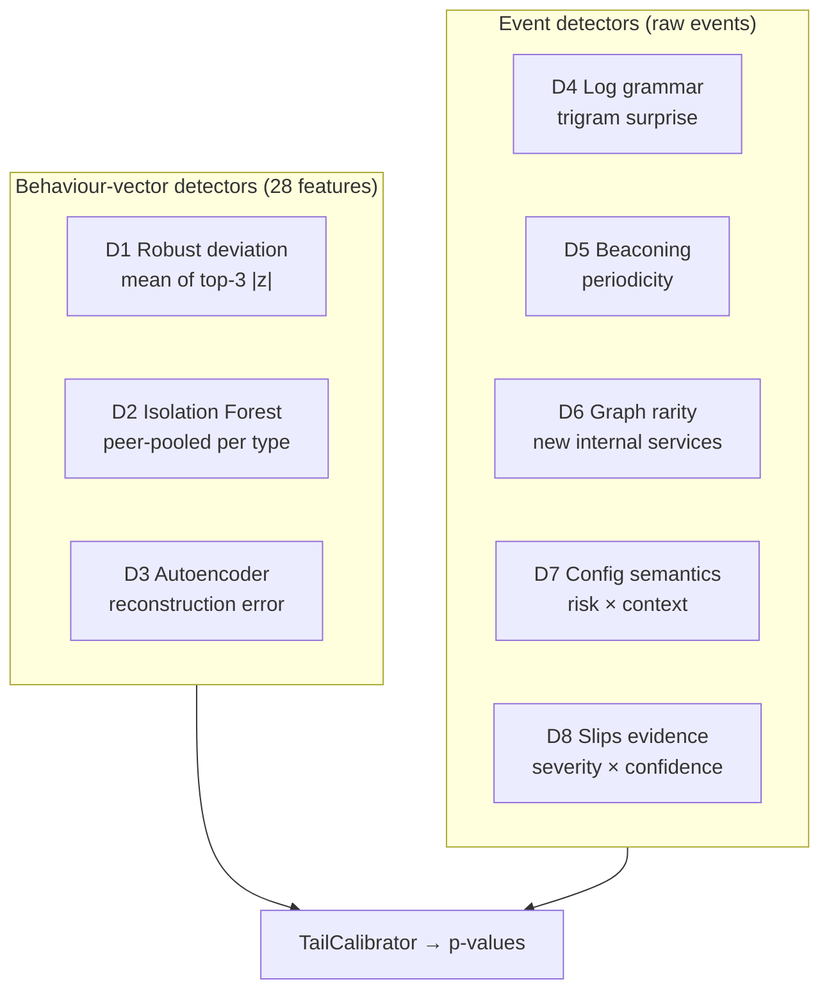
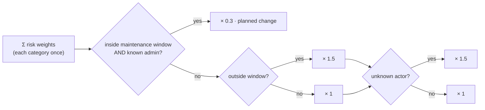

<!-- group: Engine -->
# The eight detectors

No single detector is good enough. Each one sees one facet of compromise and has blind spots; the [ablation study](12-evaluation.md) shows the best single detector still misses or misfires. TRINETRA runs eight complementary detectors and fuses them statistically.



| | Detector | Looks at | Catches | Blind to |
|---|---|---|---|---|
| D1 | Robust deviation | 28 features vs own median | any large single-feature change | combinations, sequence |
| D2 | Isolation Forest | 31-dim vector, peers of same type | unusual *combinations* | slow drifts |
| D3 | Autoencoder | 31-dim vector | subtle multi-feature patterns, time-of-day mismatch | tiny changes |
| D4 | Log grammar | syslog template order | unusual admin sessions, brute force → login → config | volume |
| D5 | Beaconing | inter-arrival times per (src, external dst) | C2 heartbeats with jitter | non-periodic C2 |
| D6 | Graph rarity | new internal (src, dst, port) edges | lateral movement, scans | external activity |
| D7 | Config semantics | config diffs + who / when / where | backdoor rules, rogue admins, tunnels, mirroring, log removal | runtime-only implants |
| D8 | Slips evidence | Slips' module detections | everything Slips knows (scans, C&C models, TI…) | non-network telemetry |

## D1 · Robust deviation from the device's own baseline

`score = mean of the three largest |z_f|` over the 28 standardised features. It is simple and transparent, and it gives the per-feature explanations shown in the console (*"never-seen process chains: 4, normal 0"*).

## D2 · Isolation Forest (peer-pooled)

An `IsolationForest(n_estimators=150)` per **device type** is trained on all devices of that type, each in its own robust units, plus the 3 time-context features. `score = −score_samples(x)`: points that random splits isolate quickly are anomalous. Pooling gives a router model ≈ 570 training windows instead of ≈ 190.

## D3 · Autoencoder

An `MLPRegressor(16-6-16, L2 α = 0.01)` per device type learns to reproduce normal vectors through a 6-unit bottleneck. `score = mean squared reconstruction error`. Inputs are clipped to ±9 and scaled ÷3 for stable training. It catches combinations the others miss, such as normal volume at an abnormal hour.

## D4 · Log grammar (DeepLog-style)

Router, firewall and host syslog has a strong grammar. A trigram model over **template ids** per device type estimates

```text
P(t | a, b) = 0.7·P_tri(t | a,b) + 0.2·P_bi(t | b) + 0.1·P_uni(t)      (add-0.01 smoothing)
score       = Σ_events max(0, −log10 P − 1)                            ("surprise mass")
```

Only events rarer than 1 in 10 contribute. Example from the router attack:

```text
snmp_poll → aaa_login_fail     (night, from the Internet)
config_exit → logging_host_removed
```

Fleet-wide new templates (e.g. `update_installed` during a patch) are learned instead of scored.

## D5 · Periodic beaconing (RITA / BAYWATCH idea)

For every (device, source, **external** destination) pair, TRINETRA keeps contact timestamps over a **3-hour** horizon. With ≥ 8 contacts:

```text
iat        = inter-arrival times (> 2 s, so bursts merge)
regularity = max(0, 1 − (MAD(iat)/median(iat)) / 0.3) × min(1, n/20)
```

- Jittered C2 (75 s ± 15 %) → MAD/median ≈ 0.075 → regularity ≈ 0.75
- Human browsing (≈ exponential) → MAD/median ≈ 0.6 → regularity 0

Benign periodic peers seen during baselining (NTP, telemetry, BGP keepalives, HA heartbeats) are **learned as known** and never alarm. Pairs below 0.5 regularity are ignored. The console shows `src → dst · every 75 s · jitter 7 % · 144 contacts / 3 h`.

## D6 · Graph rarity (lateral movement)

Each never-seen internal edge `(src, dst, port)` scores **1.0** if the destination *service* `(dst, port)` was never used by anyone on the network, else **0.3**. A worm or an operator using WinRM to a file server lights up; a user reaching the already-popular file share does not. ≥ 10 distinct new internal destinations in one window also implies **Discovery** (scanning).

## D7 · Configuration semantic drift (routers & firewalls)

Every config snapshot is diffed against the previous one. Each added/removed line is matched against **vendor-neutral risk rules**:

| Risk | Pattern (simplified) | Side | Weight | ATT&CK |
|---|---|---|---|---|
| Permissive any-rule | `permit/allow/accept … any` | added | 4 | Defense Evasion · T1562.004 |
| New privileged account | `username …` / `user …` | added | 4 | Persistence · T1136 |
| Logging removed | `logging …` / `syslog …` | removed | 5 | Defense Evasion · T1562 |
| Logging disabled | `no logging`, `log-forwarding disable` | added | 5 | Defense Evasion · T1562 |
| Tunnel to external peer | `tunnel`, `gre`, `ipsec … peer` | added | 4 | Command and Control · T1572 |
| Traffic mirroring | `monitor session`, `span`, `erspan` | added | 4 | Exfiltration · T1020.001 |
| Management plane exposed | `ip http server`, `telnet`, `api-access any` | added | 3 | Persistence · T1133 |
| NAT / port forward | `nat … static`, `port-forward` | added | 3 | Command and Control · T1090 |
| Routing change | `ip route` | added | 1.5 | Defense Evasion · T1599 |
| DNS server change | `name-server`, `dns server` | added | 3 | Credential Access · T1557 |
| Boot image / firmware | `boot system`, `firmware` | added | 4 | Defense Evasion · T1601 |
| AAA change | `aaa`, `tacacs`, `radius` | any | 3 | Credential Access · T1556 |
| Deny rule removed | `deny` | removed | 1.5 | Defense Evasion · T1562.004 |
| any other line | – | any | 0.3 | – |

Then **context multipliers**:



Worked examples from the benchmark:

| Change | Base | Context | Score |
|---|---|---|---|
| RTR-EDGE: new user + tunnel + mirror + logging removed, 23:40, `admin@<Internet IP>` | 4+4+4+5 = 17 (+0.3/other) | ×1.5 ×1.5 | **≈ 38** |
| FW-PERIM: any→RDP rule + superuser + API to any, 13:35, unknown actor | 4+4+3 = 11 | ×1.5 ×1.5 | **≈ 25** |
| RTR-CORE: static route + deny line, 01:30, `netadmin@NMS` | 1.5 + 0.3 | ×0.3 | **0.54** |

## D8 · Slips evidence

Slips' own detections arrive as `alert` events: `score = Σ severity × confidence` with severity weights critical 5, high 4, medium 3, low 1.5, info 0.5. Calibration then decides how unusual that amount of Slips evidence is for the device type, so a noisy Slips module cannot convict a device alone.
