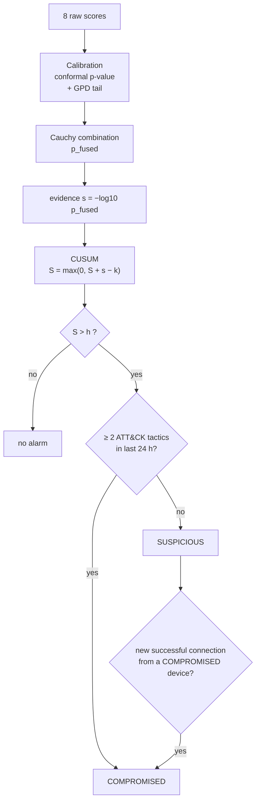
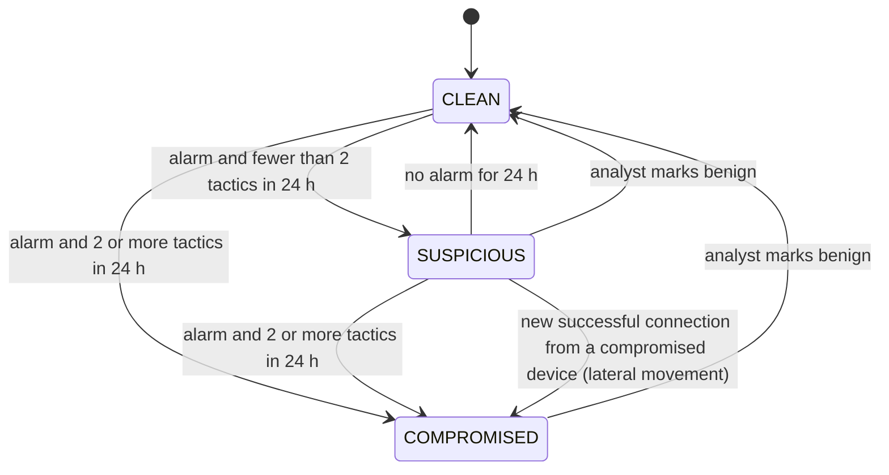
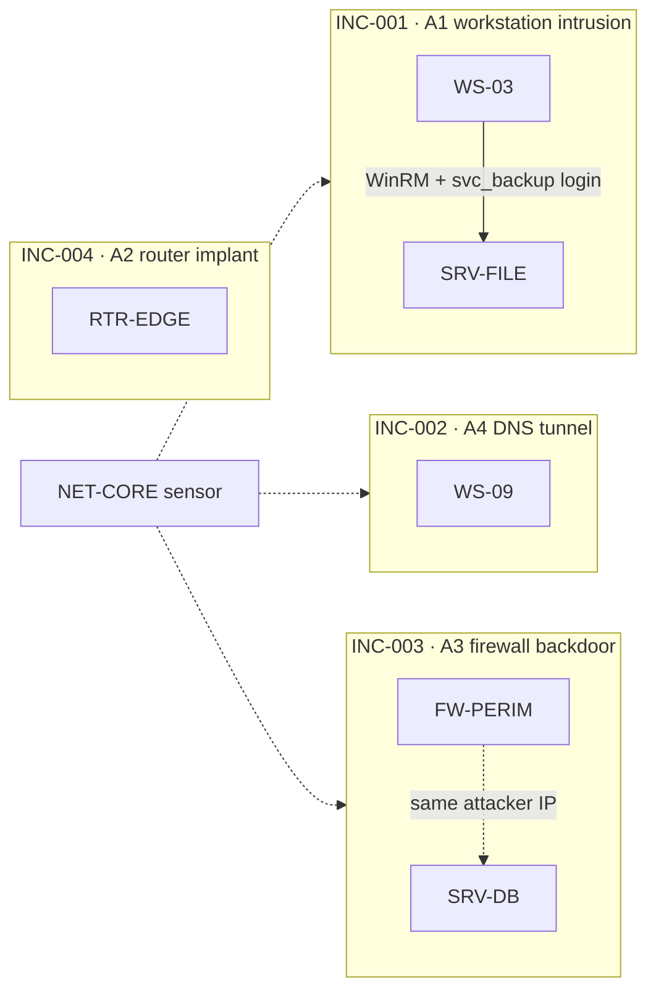

<!-- group: Engine -->
# Calibration, fusion and verdict

Eight detectors produce eight numbers on eight different scales. This page explains how TRINETRA turns them into one defensible decision.



## 1 · Calibration: every score becomes a probability

For each **device type × detector**, raw scores from held-out baseline windows form a calibration set `C = {c_1 … c_n}`. A new score `x` gets the **conformal p-value**

```text
p(x) = (1 + #{c_i ≥ x}) / (n + 1)          if x ≤ max(C)
```

Under normal behaviour this p-value is (approximately) uniform. A threshold of p < 0.01 then really means "1 in 100 normal windows". The empirical p-value cannot go below `1/(n+1)`, so beyond the largest calibration score TRINETRA extrapolates with **extreme-value theory**, as in SPOT (Siffer et al., KDD 2017). A generalised Pareto distribution is fitted to the exceedances over the 90th percentile `u`:

```text
p(x) = P(S > u) · GPD_sf(x − u; ξ, σ)        if x > max(C),   ξ clipped to [0, 0.5]
```

| Case | Tail model |
|---|---|
| ≥ 20 exceedances | GPD fit (shape ξ, scale σ) |
| 3–19 exceedances | exponential with the mean excess |
| < 3 (zero-inflated detectors such as config, beacon) | exponential with a detector-specific prior scale |

**Floors:** generic statistical detectors (Z, IForest, AE) are never trusted below **p = 10⁻⁶**; semantic detectors below **10⁻⁹**. No model is allowed to claim infinite certainty.

**Interleaved calibration:** after a 1-day burn-in, every third 2-hour block of the baseline is held out for calibration, so calibration covers days, nights, weekdays and weekends.

## 2 · Fusion: Cauchy combination

Detectors are **correlated** (a scan moves Z, IForest and graph rarity together). Fisher's method assumes independence and would over-count. The **Cauchy combination test** (Liu & Xie, JASA 2020) stays valid under arbitrary dependence in the tail:

```text
T       = (1/K) · Σ_i  tan( (0.5 − p_i) · π )        with p_i capped at 0.5
p_fused = arctan(1/T) / π                            (for T > 0, else 1)
s       = −log10(p_fused)                            "fused evidence", 0 … 30
```

Properties that matter in practice:
- **One extreme detector** gives `p_fused ≈ K · p_min` (a Bonferroni-like penalty), so one noisy detector is not enough.
- **Several moderate detectors** add up. Three detectors at p = 0.01 give a far smaller fused p than any one of them.
- Detectors with nothing to say (p ≥ 0.5) contribute exactly 0.

## 3 · Persistence: CUSUM

Single windows are noisy. Page's **CUSUM** accumulates only evidence above a reference value `k`:

```text
S_t   = max(0, S_{t−1} + s_t − k)      k = 2  (≈ p < 0.01 per window)
alarm = S_t > h                        h = 4
```

| Pattern | Effect |
|---|---|
| one window with s = 3 (p = 0.001) | S = 1 → no alarm, decays |
| one window with s = 7 (config backdoor) | S = 5 → **immediate alarm** |
| low-and-slow activity, s ≈ 3–4 every window | +1–2 per window → alarm within about an hour (DNS tunnel: 45 min) |
| normal noise, s ≈ 0.4 | S stays 0 |

The ablation without CUSUM loses 2 of the 7 attacked devices: low-and-slow attacks never cross a single-window threshold.

## 4 · Kill-chain corroboration

When a window is strong (s ≥ 3) or an alarm is active, TRINETRA **explains** it and maps the evidence to MITRE ATT&CK tactics:

| Evidence | Tactic |
|---|---|
| vector detector p < 0.01 **and** feature z above its attribution threshold (4; 2 for new process chains / new logins; 2.5 for DNS sub-domains) | from the feature table in [Features](07-features.md) |
| `n_logs` z < −4 | Defense Evasion (log suppression) |
| beacon p < 0.01 | Command and Control |
| graph p < 0.01 with an edge to a never-used service | Lateral Movement (+ Discovery if ≥ 10 new internal destinations) |
| config finding | the rule's tactic(s) |

Tactics are remembered for **24 hours** (96 windows). Then:



**COMPROMISED is sticky**: it only clears through an analyst's decision, which is the forensic norm.

## 5 · Lateral-movement propagation

A device that is already SUSPICIOUS (with at least one tactic) is escalated if, within 24 hours, it received a **new, successful** connection from a COMPROMISED device. Scans are excluded: windows in which the source touched ≥ 10 new internal destinations are not counted, otherwise one network scan would "infect" every scanned host.

Benchmark example: `SRV-FILE` was SUSPICIOUS (beaconing + exfiltration volume) and had received WinRM from compromised `WS-03` → *"Anomalous and received a new connection from compromised WS-03 (lateral movement)"*.

## 6 · Gated online learning (anti-poisoning)

After scoring, a window updates the device's novelty profile and the graph's known services **only if** `s < 1.3` (p > 0.05), no alarm is active and the device is CLEAN. A patient attacker cannot slowly teach the model that their behaviour is normal. The cost is that a **legitimate** new behaviour also stays visible (WS-07's new database use remains SUSPICIOUS) until an analyst marks it benign. That is a deliberate, explainable trade-off.

## 7 · Incidents

COMPROMISED systems and appliances are linked into one incident when their evidence shows a direct relation:
- one device's address appears in the other's new internal connections or new logins, or
- both share an **external** address (same attacker / C2 infrastructure).

Scan windows are excluded from linking. Network sensors join every incident they observed. SUSPICIOUS devices are listed as separate *watch* items. Benchmark result: **4 critical incidents = the 4 attack campaigns**, plus 2 watch items.



## Parameters

| Parameter | Value | Where |
|---|---|---|
| Window | 15 min | `schema.WINDOW` |
| CUSUM k, h | 2.0, 4.0 | `Engine(k, h)` |
| Tactic memory / SUSPICIOUS decay | 24 h | `Engine(horizon=96)` |
| Evidence recorded when | s ≥ 3 or alarm | `detect_window` |
| Gated learning | s < 1.3, no alarm, CLEAN | `detect_window` |
| Calibration tail threshold | 90th percentile | `TailCalibrator` |
| p floors | 10⁻⁶ (Z/IF/AE), 10⁻⁹ (others) | `detectors.MIN_P` |
