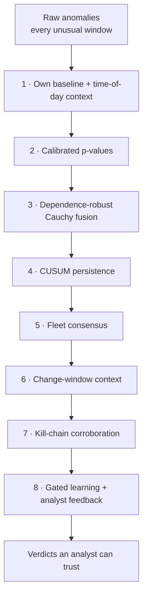

<!-- group: Engine -->
# Minimising false alarms

Anomaly-based intrusion detection has a famous weakness: in real networks, *unusual* is common and *malicious* is rare. Sommer & Paxson (IEEE S&P 2010) list false-alarm cost as the main reason such systems fail in practice. With 22 devices and 96 windows a day, a detector that is wrong 1 % of the time raises **21 false alarms per day**. TRINETRA stacks eight independent layers to stop that.

| # | Layer | What it suppresses | Benchmark trap it handles |
|---|---|---|---|
| 1 | Per-device baseline + hour-of-day context | "The file server always moves gigabytes at 02:00" | nightly backup job on SRV-FILE |
| 2 | Conformal + EVT calibration | detectors with naturally wide score ranges; arbitrary thresholds | all |
| 3 | Cauchy fusion | one noisy detector cannot convict alone | – |
| 4 | CUSUM | one-off blips; keeps low-and-slow attacks | B5 research browsing spree |
| 5 | Fleet consensus with look-ahead | organisation-wide change | **B1 patch rollout on 16 hosts** |
| 6 | Maintenance window + known admin | planned configuration changes | **B3 planned route change** |
| 7 | Kill-chain corroboration | single-stage oddities stay SUSPICIOUS | **B2 new DB usage**, **B6 backup surge** |
| 8 | Gated learning + "Mark benign" | baseline poisoning; repeat alerts after review | analyst closes B2 / B6 |

## Evidence: the ablation study

Same data, same baseline; one layer removed at a time (seed 7):

| Variant | Attacked caught | Clean devices convicted | Clean devices alarmed (any level) |
|---|---|---|---|
| **Full system** | **7 / 7** | **0** | **2** |
| Without fleet consensus | 7 / 7 | 1 | 13 |
| Without kill-chain corroboration | 7 / 7 | 2 | 2 |
| Without CUSUM persistence | 5 / 7 | 0 | 0 |

What it shows:
- **Fleet consensus** is the biggest noise reducer: 13 → 2 clean devices alarmed during the patch rollout.
- **Corroboration** turns persistent but single-stage anomalies (backup surge, new DB app) into SUSPICIOUS instead of COMPROMISED.
- **CUSUM** costs nothing in false alarms and is required for recall: without it, 2 of the 7 attacked devices are missed, because their evidence is steady but never extreme in any single window.

## Three verdict levels instead of a binary alarm

| Level | Meaning | Expected analyst action |
|---|---|---|
| CLEAN | within baseline | none |
| SUSPICIOUS | persistent anomaly, single stage | review within the shift; mark benign or collect more data |
| COMPROMISED | persistent anomaly corroborated by ≥ 2 ATT&CK stages, or lateral movement from a compromised device | incident response now (playbook in the report) |

In the benchmark the two clean devices that reached SUSPICIOUS have legitimate explanations: a user starting a new application and a large backup. In real operations those are exactly the changes an analyst wants to see once and then approve.

## Metrics we report (base-rate aware)

Following Arp et al. ("Dos and Don'ts of ML in Computer Security", USENIX Security 2022), we report **device-level** precision and recall, **alarm windows per clean device-day** (1.29 in the benchmark, all on the two SUSPICIOUS devices) and median time-to-detect. Accuracy is not reported because it is meaningless at security base rates.
