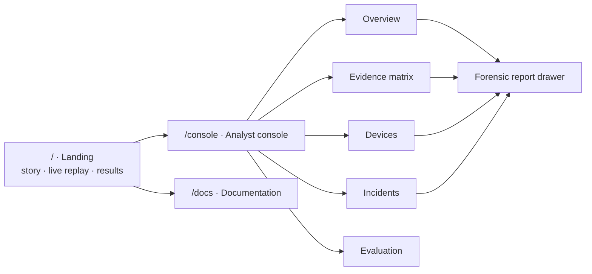

<!-- group: Interface -->
# Console, reporting and API

TRINETRA ships three web surfaces from one Flask server, all in a monochrome design. State is never shown by colour alone: **COMPROMISED** = solid white (inverted) with ✕, **SUSPICIOUS** = hatched outline with !, **CLEAN** = quiet outline with ✓. This works on projectors, in print and for colour-blind users.



## Landing page (`/`)

| Section | Content |
|---|---|
| Hero | Headline with rotating device word, animated network scene that tilts with the cursor, live numbers, and a **ticker of real log lines** from public malware captures |
| Platforms | Linux distributions, Docker, Python stack, SIEMs (marquee) |
| Devices | Bento grid of **real photographs** (router, firewall, switches, servers, SOC, data centre, fibre, wiring). Hover: scanning animation, parallax, what TRINETRA watches on that device, status hotspot; click: full-size photo with credit |
| Problem | IoC vs behavioural detection, timeline of real edge-device compromises (SYNful Knock → CISA ED 25-03) |
| How it works | 5-step pipeline and the four device classes |
| **Real logs** | Five real captures shipped with Slips (Remcos RAT from the expert-labelled CTU-SME-11 set, Mozi IoT botnet, vertical port scan, telnet/IoT scanning, Suricata signature alerts). Lines stream in like a terminal (pause, replay, click for the raw record); side panel shows measured signals, the real contact rhythm, **TRINETRA's own feature values computed on the capture** and what they mean |
| Detectors | The 8 detectors |
| False alarms | The 8 layers + live ablation bars from the latest analysis |
| Results | Precision, recall, false compromises, time-to-detect, scenario outcomes |
| **Console** | Browser-framed, auto-rotating real screenshots of the console (overview, matrix, ATT&CK, timeline, forensic report, executive report, dark mode); tilts flat as you scroll, click to enlarge |
| Research · Docs · Get started | Paper library with filters, documentation cards, install commands |
| Credits | Photo authors and licences, log capture sources |

Motion: scroll-progress bar, word-by-word heading reveals, cursor spotlight on cards, magnetic primary buttons, count-ups. All of it is switched off under `prefers-reduced-motion`; `/#still` renders a static page for screenshots.

**Where the real data comes from.** `python -m compromise_dashboard.build_real_logs` reads the captures in `dataset/`, copies excerpts verbatim into `static/data/real_logs.json`, and runs `features.compute` on the busiest 15-minute window of each flow capture. Nothing on the landing page's log panel is generated. Photos are Wikimedia Commons files under CC0 / CC BY / CC BY-SA; author, licence and source link for each are in `static/img/photos/credits.json` and at the bottom of the page.

## Console (`/console`)

### Global controls
- **Timeline / replay.** The whole UI is time-aware. Drag the slider, press **▶** (or the space bar), or click a tick on the timeline: white ticks are COMPROMISED verdicts, hatched ticks SUSPICIOUS. Everything (status, map, feed, matrix, report) shows the network *as it was* at that moment.
- **Sidebar.** Views, CEF/JSON export, docs, re-run analysis, engine metadata.

### Overview
| Panel | What it shows |
|---|---|
| Status bar | Network-level verdict; inverted white when anything is compromised |
| KPIs | Monitored, compromised, suspicious, clean, open incidents |
| Network map | Firewalls → routers → sensors → systems; dashed moving lines = attack paths in order of compromise |
| Verdict feed | Every verdict change with its reason |
| Open incidents | Cards per incident with stage count |

### Evidence matrix
Every device (rows) × every 15-minute window (columns). Brightness = fused evidence −log₁₀ p (0 → 8+). A dotted underline marks alarm windows; a solid underline marks windows after the device was convicted. Attack campaigns appear as bright horizontal streaks; benign traps as faint flickers. Hover for exact values; click a row to open the device.

### Devices
Searchable, filterable table: class, address, verdict, **evidence sparkline**, peak evidence, ATT&CK stages.

### Incidents
Per incident: devices, a 10-cell **ATT&CK stage strip** (lit cells = observed stages), and the chronological kill chain (time · device · tactic · technique).

### Forensic report (drawer)
| Block | Content |
|---|---|
| Header | Device, class, address, coverage (n/8 detectors), verdict |
| Verdict reason | Why, and since when |
| Evidence chart | Fused evidence per window, p = 0.01 reference, hatched alarm spans, verdict markers |
| Detector coverage | Which of the 8 detectors watch this device |
| Strongest evidence | Up to 6 windows: tactics, per-detector −log₁₀ p bars, *what changed vs normal* (now vs median), config diff with actor/window/risk, beacon period & jitter, new process chains, logins, internal connections, Internet destinations, domains, unusual log sequences, Slips evidence |
| Recommended actions | Device-type playbook (host, firewall, router, network) |
| Actions | **Mark benign** (analyst feedback), **Print** (clean print stylesheet for a PDF report) |

## Interactive labs and presentation tools

| Feature | Where | What it does |
|---|---|---|
| **Story mode** | top bar · key **S** | Auto-narrated walkthrough: the replay jumps to every verdict change, zooms the map onto the device and shows a plain-language caption (English or हिंदी). ← / → to step, auto-play every 7 s. |
| **Live attack lab** | sidebar · *Live attack lab* | Pick one of the four attacks. A fresh week is simulated with only that attack, the engine learns 4 clean days, then the test days stream window by window into the console. Nothing is pre-computed. Toasts announce each verdict. |
| **What-if lab** | sidebar · *What-if lab* | Sliders for CUSUM *k* and *h*, switches for fleet consensus, kill-chain corroboration and CUSUM, and a checkbox per detector. The benchmark week is re-scored and recall, precision, false convictions, alarmed clean devices and time-to-detect are shown with deltas against the default. |
| **ATT&CK map** | sidebar | MITRE ATT&CK coverage: 10 tactic columns, one cell per technique attributed from behaviour, shaded by number of devices. |
| **Attack timeline** | sidebar | One swim-lane per device: evidence dots (size = evidence, red = mapped to an ATT&CK stage), tactic abbreviations and verdict flags. |
| **"Why this verdict?"** | device report | Deterministic plain-language explanation (EN / हिंदी): first anomaly, key evidence, why it was convicted, first response step. |
| **Executive report** | sidebar · *Executive report (PDF)* | `/report`: printable A4 report (cover, executive summary, incidents with kill chains, per-device explanations and playbooks, device table, detection quality, methodology). Use *Print → Save as PDF*. |
| **Upload your data** | sidebar | Drag & drop UBT `.jsonl` + `inventory.json`, Zeek `conn.log`/`dns.log`, Slips `alerts.json`, router/firewall syslog or config backups. A sample dataset can be downloaded from the same dialog. |
| **Interactive map** | overview | Hover to trace a device's links, drag devices to rearrange (saved), scroll to zoom, drag the background to pan, minimap when zoomed, filters for compromised / suspicious / attack paths. |
| **Toasts + sound** | everywhere | Pop-ups when a device changes verdict during replay or a live run. Alert sound can be switched on in the command palette. |

### Keyboard shortcuts

| Key | Action |
|---|---|
| **Ctrl + K** | Command palette: jump to any view, device or action |
| **Space** | Play / pause the replay |
| **S** | Start story mode (← → to step, Esc to exit) |
| **P** | Presenter mode: hides the sidebar and enlarges everything for a projector |
| **D** | Dark / light theme (also `?theme=dark` in the URL) |
| **L** | English / हिंदी |
| **Esc** | Close the report drawer, palette or story |

The console is responsive: below 1200 px the sidebar becomes a slide-in menu (☰), and on phones the map scrolls horizontally.

## REST API

| Method | Path | Body / response |
|---|---|---|
| GET | `/api/results` | full analysis (see schema below); 404 until the first analysis finishes |
| GET | `/api/status` | `{running, progress, message, error, has_results}` |
| POST | `/api/run` | `{"seed": 7, "ablations": true}` → 202 started / 409 already running |
| POST | `/api/mark_benign` | `{"device": "WS-07"}` → verdict CLEAN, feedback logged |
| GET | `/api/export/cef` | one CEF line per device |
| GET | `/api/export/json` | full report download |
| GET | `/api/docs` | documentation index |
| GET | `/docs/raw/<slug>` | one Markdown page |
| POST | `/api/whatif` | `{"k":2,"h":4,"consensus":true,"corroboration":true,"cusum":true,"detectors":[…]}` → evaluation of the benchmark week with those settings (cached per setting) |
| POST | `/api/live/start` | `{"scenario":"A2"}` → starts a live run; `GET /api/live/state?since=<seq>` returns progress and the latest snapshot; `POST /api/live/stop` |
| GET | `/api/scenarios` | the four attack scenarios |
| POST | `/api/upload` | multipart: `file0…fileN`, `meta` (kind/device/type per file), `train_frac` → background analysis |
| GET | `/api/sample` | zip with a sample `ubt_events.jsonl` + `inventory.json` |
| POST | `/api/restore_demo` | switch back to the simulated benchmark after an upload |
| GET | `/report` | printable executive report (`?print=1` opens the print dialog) |

### Results schema (abridged)

```json
{
  "devices": [{"id": "RTR-EDGE", "type": "router", "ip": "10.0.0.2", "verdict": "COMPROMISED",
               "reason": "Persistent anomaly corroborated by multiple attack stages: …",
               "compromised_at": 1791243000, "first_alarm": 1791243000, "max_score": 7.2,
               "alarm_windows": 194, "tactics": ["Command and Control", "Defense Evasion", "…"],
               "coverage": ["autoenc", "beacon", "config", "graph", "iforest", "sequence", "zscore"]}],
  "timeline": {"RTR-EDGE": [[ts, s, S], …]},
  "evidence": {"RTR-EDGE": [{"ts": …, "score": 7.2, "alarm": true, "detectors": {"config": 8.0, …},
                "top_features": [{"feature": "failed logins", "value": 6, "normal": 0, "z": 12}],
                "tactics": {"Persistence": ["T1136 Create Account"]}, "config": [{…diff…}],
                "beacon": null, "new_internal": [], "new_external": [], "new_processes": [],
                "new_logins": ["admin@212.221.199.156"], "odd_logs": ["config_exit -> logging_host_removed"]}]},
  "verdict_events": [{"ts": …, "device": "RTR-EDGE", "from": "CLEAN", "to": "COMPROMISED", "reason": "…"}],
  "incidents": [{"id": "INC-004", "severity": "critical", "devices": ["RTR-EDGE"], "tactics": […], "kill_chain": […]}],
  "evaluation": {"precision": 1.0, "recall": 1.0, "f1": 1.0, "median_ttd_min": 45, …},
  "ablation": [{"variant": "Full system (all layers)", "tp": 7, "fp": 0, …}],
  "params": {"k": 2.0, "h": 4.0, "horizon_h": 24, "window_min": 15, "consensus_latency_min": 30},
  "meta": {"source": "simulation", "n_events": 414080, "detectors": {…}},
  "actions": {"router": ["Collect running + startup config …"]}
}
```

### CEF export

```text
CEF:0|TRINETRA|Compromise Detector|0.1|verdict-compromised|Device RTR-EDGE COMPROMISED|10|rt=1791243000000 dvchost=RTR-EDGE dvc=10.0.0.2 cs1Label=deviceType cs1=router cs2Label=tactics cs2=Command and Control, Defense Evasion, Exfiltration, Persistence cs3Label=reason cs3=Persistent anomaly corroborated … cn1Label=maxEvidence cn1=7.2
```

Severity: COMPROMISED 10, SUSPICIOUS 6, CLEAN 1. Any SIEM that accepts CEF over a file or syslog (Splunk, QRadar, ArcSight, Wazuh, Elastic) can ingest it.

## Front-end engineering notes

| Choice | Reason |
|---|---|
| Vanilla JS, no build step | runs from a USB stick in an air-gapped SOC |
| SVG for map and charts, Canvas for the 22 × 288 matrix and landing animation | crisp vectors where interaction matters, speed where there are thousands of cells |
| Vendored marked + mermaid | docs render offline |
| Deep links `#view=matrix`, `#device=RTR-EDGE`, `#t=start` | direct links in slides and reports |
| `prefers-reduced-motion` respected | accessibility |
| Print stylesheet | the forensic drawer prints as a clean report |
