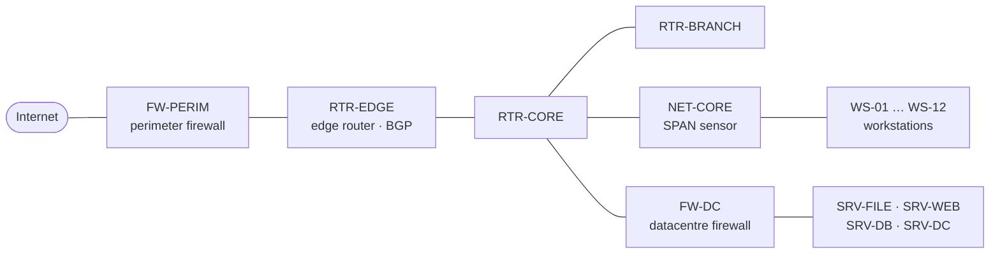
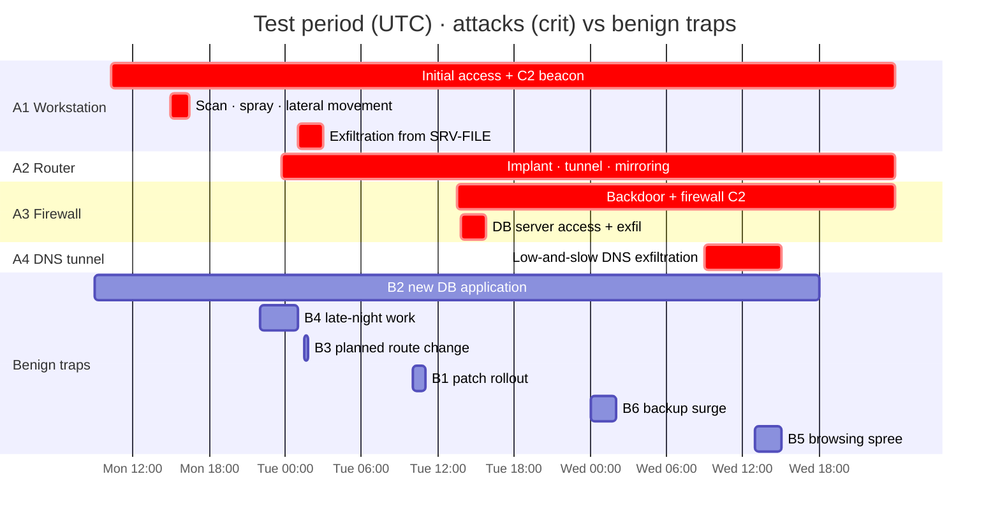

<!-- group: Evaluation -->
# Evaluation

## Why a purpose-built testbed?

Public IDS datasets (CIC-IDS2017, UNSW-NB15, CTU-13, Slips' own captures) contain **network flows only**. None has router or firewall **configurations**, appliance **syslog**, host **logins and process chains** and network flows *together*, with ground truth. That combination is exactly what a cross-device compromise detector needs. `simulate.py` therefore generates a realistic enterprise with labelled attacks **and** labelled benign look-alikes.

## The simulated enterprise



| Property | Value |
|---|---|
| Devices | 22: 12 workstations, 4 servers, 3 routers, 2 firewalls, 1 network sensor |
| Duration | 7 days (Thu–Wed): **4 baseline** + **3 test** |
| Events | 414,080 |
| Realism | weekday/weekend and diurnal rhythms, lunch dip, Zipf-distributed favourite sites, 2.5 % never-seen sites, benign high-entropy CDN names, benign periodic telemetry/NTP/BGP/HA, daily admin sessions on network devices, nightly backup job, rare benign new applications, planned config changes during baseline |
| IoC-free attacks | every attacker IP and domain is freshly random; tools are living-off-the-land process names |

## Scenarios

| ID | Type | Devices | What happens |
|---|---|---|---|
| A1 | attack | WS-03 → SRV-FILE (+ NET-CORE) | Malicious document → script host → shell; jittered C2 beacon (75 s ±15 %); internal scan of 60 IPs × 5 ports; credential spraying; WinRM lateral movement with stolen `svc_backup`; file-server beacon; night-time exfiltration |
| A2 | attack | RTR-EDGE | 23:40 brute force from the Internet; rogue `maint` privilege-15 user; GRE tunnel and ERSPAN mirroring to attacker; syslog host removed (log volume drops to 8 %) |
| A3 | attack | FW-PERIM → SRV-DB | 40 failed admin logins; `permit tcp any → DB:3389`; rogue superuser; management API opened to any; firewall-originated C2 every 5 min; attacker RDPs to the DB server, runs `sql_dump`, exfiltrates |
| A4 | attack | WS-09 | Six hours of 30–42-character random sub-domains under a never-seen domain (DNS tunnelling) |
| B1 | benign | all 16 hosts | Patch rollout: new update servers, installer process, new log type, CPU spike |
| B2 | benign | WS-07 | User starts a database application: new internal edge to SRV-DB:1433 every working day |
| B3 | benign | RTR-CORE | Known admin adds a static route inside the maintenance window |
| B4 | benign | WS-11 | Works 22:00–01:00 at daytime intensity |
| B5 | benign | WS-05 | Two hours browsing dozens of never-seen sites |
| B6 | benign | FW-DC | Backup surge: triple log volume, large internal transfers |



## Protocol

- **Time-ordered split.** Learn on the 4 baseline days; detect on the 3 following days. No shuffling, no attack data in training (unsupervised).
- **Device-level metrics.** A device counts as detected if its final verdict is COMPROMISED. Precision, recall and F1 are over 7 attacked and 15 clean devices.
- **Time to detect (TTD).** Start of the window in which the device was convicted minus the device's first labelled attacker action. Verdicts are emitted at the end of the window plus the 30-minute consensus look-ahead.
- **False-alarm rate.** Alarm windows on clean devices per clean device-day.

## Results (seed 7)

| Metric | Value |
|---|---|
| Recall | **7 / 7** (1.00) |
| Precision | **1.00** (0 clean devices convicted) |
| F1 | **1.00** |
| Median TTD | **30 min** |
| Clean devices reaching SUSPICIOUS | 2 (WS-07 = B2, FW-DC = B6) |
| Alarm windows per clean device-day | 1.29 (all on those two devices) |

### Detection timeline

| Window (UTC) | Device | Verdict | Reason (abridged) |
|---|---|---|---|
| Mon 10:15 | WS-03 | COMPROMISED | Command and Control + Execution (new process chain, beacon) |
| Mon 11:30 | NET-CORE | COMPROMISED | Command and Control + Lateral Movement seen on the wire |
| Mon 12:45 | WS-07 | SUSPICIOUS | new DB usage (B2), single stage |
| Mon 16:15 | SRV-FILE | SUSPICIOUS | persistent anomaly |
| Mon 17:00 | SRV-FILE | COMPROMISED | received new connection from compromised WS-03 |
| Mon 23:30 | RTR-EDGE | COMPROMISED | C2 + Defense Evasion + Exfiltration + Persistence |
| Tue 13:30 | FW-PERIM | COMPROMISED | Credential Access + Defense Evasion + Persistence |
| Tue 14:15 | SRV-DB | COMPROMISED | Execution + Exfiltration |
| Wed 00:15 | FW-DC | SUSPICIOUS | backup surge (B6), no attack stage |
| Wed 09:45 | WS-09 | COMPROMISED | Command and Control + Exfiltration (DNS) |

Per-device TTD: WS-03, RTR-EDGE and FW-PERIM in the first window (0 min); SRV-DB 30 min; WS-09 45 min; SRV-FILE 60 min; NET-CORE 75 min.

Ground truth note: failed login attempts (A1's credential spraying against SRV-FILE and SRV-DB) are attacker activity but do **not** compromise the target, so they are not labelled as compromise on those servers. A device's TTD is measured from the first action that actually compromises it (for SRV-DB: the A3 attacker's successful login on Tuesday).

### Ablation study

| Variant | TP | FP | FN | Precision | Recall | F1 | Clean alarmed | Median TTD |
|---|---|---|---|---|---|---|---|---|
| **Full system (all layers)** | 7 | 0 | 0 | 1.00 | 1.00 | **1.00** | 2 | 30 |
| Without fleet consensus | 7 | 1 | 0 | 0.88 | 1.00 | 0.93 | 13 | 0 |
| Without kill-chain corroboration | 7 | 2 | 0 | 0.78 | 1.00 | 0.88 | 2 | 15 |
| Without CUSUM persistence | 5 | 0 | 2 | 1.00 | 0.71 | 0.83 | 0 | 0 |
| Robust deviation alone | 6 | 0 | 1 | 1.00 | 0.86 | 0.92 | 0 | 300 |
| Isolation Forest alone | 1 | 0 | 6 | 1.00 | 0.14 | 0.25 | 0 | 45 |
| Autoencoder alone | 7 | 1 | 0 | 0.88 | 1.00 | 0.93 | 1 | 30 |
| Log grammar alone | 3 | 1 | 4 | 0.75 | 0.43 | 0.55 | 1 | 0 |
| Beaconing alone | 4 | 0 | 3 | 1.00 | 0.57 | 0.73 | 0 | 75 |
| Graph rarity alone | 3 | 1 | 4 | 0.75 | 0.43 | 0.55 | 1 | 285 |
| Config semantics alone | 1 | 0 | 6 | 1.00 | 0.14 | 0.25 | 0 | 0 |

(Single-detector rows run without corroboration, so each detector can convict on its own.)

**Reading the table:** no single detector matches the fused system. The autoencoder alone catches all seven but also convicts a clean device; robust deviation alone misses one attack and is 5 hours slower. Removing a false-alarm layer always costs something: without consensus 13 clean devices alarm and one is convicted, without corroboration two are convicted, without CUSUM two attacks are missed. Specialist detectors (config, log grammar, beacon) are precise and fast on their own attack class but blind to the others.

### Robustness across seeds

Every seed re-randomises traffic, attacker IPs, domains and timings. Live-lab style runs simulate a week with only one attack.

| Seed | Attacks | Caught | Clean devices convicted | Median TTD |
|---|---|---|---|---|
| 7 | all four | 7 / 7 | 0 | 30 min |
| 11 | all four | 7 / 7 | 0 | 15 min |
| 42 | all four | 7 / 7 | 0 | 15 min |
| 99 | A1 only | 3 / 3 | 0 | 30 min |
| 201 | A2 only | 1 / 1 | 0 | 0 min |
| 303 | A4 only | 2 / 2 | 0 | 345 min |

Seed 201 found a real weakness that is now fixed: during the Tuesday patch rollout the network sensor NET-CORE sees the whole segment's patch traffic at once, and with one benign new DB connection that looked like C2 + lateral movement. The engine now notices a **fleet-wide change in progress** (an item spreading to ≥ 50 % of a device class within an hour) and, while it lasts, ignores the sensor's pure volume detectors (z-score, Isolation Forest, autoencoder); specialist detectors keep running. In seed 303 the DNS tunnel on the sensor is still caught, but later (345 min median), because the sensor's volume detectors are muted during that week's patch window.

## Limitations (stated plainly)

1. **Simulated data.** The scenarios are realistic but designed by us, and the detector logic was developed alongside them. Results must be confirmed on independent data.
2. **Few seeds.** Six seeds are reported above; a larger sweep with confidence intervals is on the roadmap. Use **Re-run analysis** (random seed) or `--rebuild --seed N` to check any seed yourself.
3. **Slips module not yet executed live** (Windows development machine without Docker/Redis).
4. **Baseline assumed clean.** Mitigation: onboarding integrity checks and peer comparison.

## Reproduce

```bash
python -m compromise_dashboard --rebuild --seed 7
# or headless
python -c "from modules.compromise_detector.core.pipeline import run_demo; import json; r=run_demo(7); print(json.dumps(r['evaluation'], indent=1)); print(r['ablation'])"
```

## Next validation steps

| Step | Data | What it proves |
|---|---|---|
| Network component on public data | CIC-IDS2017, CTU-13 (botnet beaconing), UGR'16 (ISP NetFlow) | beacon/graph/vector detectors on real traffic and real noise |
| Lateral movement | LANL Unified Host & Network | auth + flow fusion at enterprise scale |
| Network appliances | GNS3 / EVE-NG lab with real router and firewall images, scripted attacks | config, syslog and AAA detectors on real vendor output |
| Live Slips | Slips Docker on a lab segment | end-to-end module operation |
