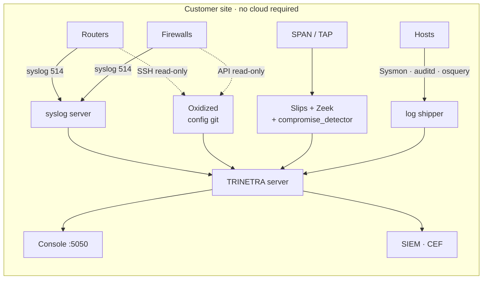
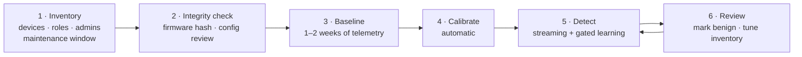

<!-- group: Operations -->
# Deployment

## Deployment modes

| Mode | Data path | Best for |
|---|---|---|
| **Agentless** | routers/firewalls → syslog server; configs pulled by Oxidized (read-only SSH); NetFlow/IPFIX → collector | network appliances, legacy and critical-infrastructure systems where agents are forbidden |
| **Passive sensor** | SPAN/TAP → Zeek → **Slips + compromise_detector** | whole-network visibility |
| **Light host telemetry** | Sysmon / auditd / osquery / Wazuh agent → logs | servers and workstations |
| **Demo / air-gapped laptop** | built-in testbed | evaluation, training, judging |



## 1 · Demo on any laptop

```bash
cd slips
pip install -r compromise_dashboard/requirements.txt
python -m compromise_dashboard        # http://127.0.0.1:5050
```

## 2 · Slips with the TRINETRA module (Linux / Docker)

Follow Slips' own installation (`docker/` or `install/` in this repository; see `README.md` and `docs/` of Slips). The module is auto-discovered. Then:

```bash
./slips.py -i eth0                       # live, or: -f capture.pcap
python -m compromise_dashboard --slips-output output/<run_folder>
```

`--slips-output` loads `compromise_detector/ubt_events.jsonl` and `inventory.json`, learns a baseline on the first 60 % of the time span and analyses the rest. For production, keep a fixed baseline period (1–2 weeks recommended) and stream detection afterwards.

## 3 · Adding routers and firewalls

1. **Syslog:** send device logs to a collector file per device.
2. **Configs:** back them up periodically (Oxidized, RANCID, vendor API). One file per version is enough.
3. **Inventory:** list each device with `type` `router` or `firewall`, its management IP, the maintenance window and the network-admin accounts:

```json
{"devices": [{"id": "RTR-EDGE", "type": "router", "ip": "10.0.0.2", "role": "edge router"}],
 "maintenance_hours": [1, 3], "admins": [["netadmin", "10.0.3.20"]], "tz_offset_hours": 5.5}
```

4. **Merge and analyse:**

```python
from modules.compromise_detector.core.adapters import read_syslog, read_config_snapshots, load_slips_export
from modules.compromise_detector.core.schema import Inventory
from modules.compromise_detector.core.pipeline import run_real
import json

events, inv = load_slips_export("output/run1/compromise_detector")
net = Inventory.from_dict(json.load(open("network_inventory.json")))
inv.devices.update(net.devices); inv.admins |= net.admins; inv.maintenance_hours = net.maintenance_hours
events += read_syslog("logs/rtr-edge.log", "RTR-EDGE") + read_config_snapshots("backups/rtr-edge", "RTR-EDGE")
events.sort(key=lambda e: e.ts)
report = run_real(events, inv, train_end=events[0].ts + 14 * 86400)
```

## Onboarding checklist



## Hardening the tool itself

| Risk | Control |
|---|---|
| Collector credentials abused | read-only accounts for config pulls; TACACS command authorisation |
| Telemetry tampering by a compromised device | cross-view detection: sensor/NetFlow vs device self-report; log-volume drop is itself evidence |
| Console exposure | bind to `127.0.0.1` or a management VLAN; put behind a reverse proxy with authentication for multi-user use |
| Baseline poisoning | gated learning; re-baseline only with analyst approval |

## Sizing

| Scale | Engine cost |
|---|---|
| 22 devices, 7 days (414 k events) | ≈ 30 s end-to-end on a laptop CPU (≈ 3 min including the 10-variant ablation study) |
| Detection per 15-minute window | milliseconds per device; vector models are scored in one batch per device type |
| Memory | dominated by event buckets; stream from disk for larger estates |

The engine scales roughly linearly with devices × windows. For thousands of devices, shard by site: one engine per segment, with incidents merged centrally.
