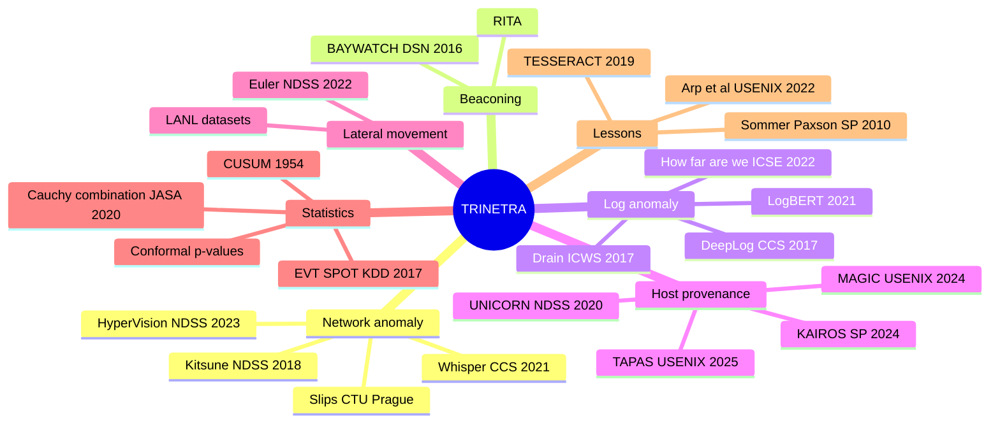

<!-- group: Research -->
# Research background

TRINETRA combines several research lines that are usually studied in isolation. The full literature survey is in `RESEARCH.md` at the project root; this page is the condensed map.

## Positioning

| Capability | Kitsune | DeepLog | RITA | KAIROS / MAGIC | Slips | **TRINETRA** |
|---|:-:|:-:|:-:|:-:|:-:|:-:|
| Works without IoCs | ✓ | ✓ | ✓ | ✓ | ✓ (mostly) | ✓ |
| Systems | – | logs | – | ✓ | network view | ✓ |
| Firewalls | – | logs | – | – | – | ✓ |
| Routers | – | logs | – | – | – | ✓ |
| Whole network | ✓ | – | ✓ | – | ✓ | ✓ |
| Config-semantic drift | – | – | – | – | – | ✓ |
| Calibrated multi-detector fusion | – | – | – | – | threshold | ✓ |
| Kill-chain corroboration | – | – | – | partial | – | ✓ |
| Device verdict + forensic report | – | – | partial | summary graphs | alerts | ✓ |
| CPU only, offline | ✓ | ✓ | ✓ | GPU typical | ✓ | ✓ |

## What is new in TRINETRA

1. **Unified Behavioural Telemetry:** one feature space and engine for systems, firewalls, routers and networks.
2. **Configuration-semantic drift as a learned, context-scaled signal** for network appliances. It is largely absent from ML-IDS research, yet central to real edge-device intrusions (Volt Typhoon, ArcaneDoor, COATHANGER).
3. **Calibrated fusion:** conformal p-values with EVT tails per detector, combined with the dependence-robust Cauchy combination test. Thresholds become false-alarm probabilities.
4. **Kill-chain corroboration:** conviction requires multiple ATT&CK stages, matching how intrusions actually unfold.
5. **Fleet consensus with look-ahead:** organisation-wide change is separated from targeted intrusion.
6. **Gated online learning:** the baseline never absorbs suspicious windows (anti-poisoning).
7. **Peer-pooled small-data learning:** per-device robust units let routers learn from routers.

## Answers to the classic critiques

| Critique | Source | TRINETRA's answer |
|---|---|---|
| Anomaly ≠ attack; false-positive cost | Sommer & Paxson 2010 | calibrated fusion + corroboration + 3 verdict levels |
| Semantic gap: alerts not explainable | Sommer & Paxson 2010 | per-feature "now vs normal", detector bars, config diff, ATT&CK mapping |
| Data snooping, unrealistic data, base-rate fallacy | Arp et al. 2022 | time-ordered split, no attack data in training, per-device-day false-alarm rate, honest limitations |
| Concept drift | Pendlebury et al. 2019 | gated learning, fleet consensus, recalibration, analyst feedback |
| Deep log models over-optimistic | Le & Zhang 2022 | lightweight interpolated n-gram; log grammar is one detector of eight |

## Key references

1. Mirsky et al. *Kitsune.* NDSS 2018.
2. Fu, Li, Xu. *HyperVision: unknown encrypted malicious traffic.* NDSS 2023.
3. Hu et al. *BAYWATCH: robust beaconing detection.* IEEE/IFIP DSN 2016.
4. He et al. *Drain: online log parsing.* ICWS 2017.
5. Du et al. *DeepLog.* ACM CCS 2017.
6. Le & Zhang. *Log-based anomaly detection with deep learning: how far are we?* ICSE 2022.
7. Han et al. *UNICORN.* NDSS 2020. Cheng et al. *KAIROS.* IEEE S&P 2024. Jia et al. *MAGIC.* USENIX Security 2024. Zhang et al. *TAPAS.* USENIX Security 2025.
8. King & Huang. *Euler: lateral movement via temporal link prediction.* NDSS 2022.
9. Bates, Candès, Lei, Romano, Sesia. *Testing for outliers with conformal p-values.* Annals of Statistics 2023.
10. Siffer et al. *Anomaly detection in streams with extreme value theory (SPOT).* KDD 2017.
11. Liu & Xie. *Cauchy combination test.* JASA 2020.
12. Page. *Continuous inspection schemes (CUSUM).* Biometrika 1954.
13. Liu, Ting, Zhou. *Isolation Forest.* ICDM 2008.
14. Sommer & Paxson. *Outside the closed world.* IEEE S&P 2010.
15. Arp et al. *Dos and don'ts of machine learning in computer security.* USENIX Security 2022.
16. Pendlebury et al. *TESSERACT.* USENIX Security 2019.
17. Garcia et al. *Stratosphere Linux IPS (Slips).* Stratosphere Laboratory, CTU Prague.
18. CISA et al. *AA24-038A Volt Typhoon* (2024); *Identifying and Mitigating LOTL Techniques* (2024); joint *edge-device guidance* (Feb 2025); *Emergency Directive 25-03* (Sep 2025).
19. MITRE ATT&CK Enterprise matrix.

> Verify every reference (title, venue, year) on DBLP / Google Scholar before formal submission.
