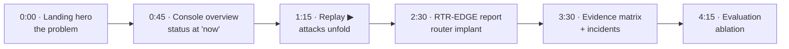

<!-- group: Presenting -->
# Presentation guide

A ready-to-use script for presenting TRINETRA to judges, with the exact screens to show and answers to the questions they are most likely to ask.

## Before you present

- [ ] `python -m compromise_dashboard` is running and `/console` loads instantly (cached results).
- [ ] Browser zoom at 90–100 %, full screen (F11).
- [ ] Tabs open: `/` (landing), `/console`, `/console#device=RTR-EDGE`, `/docs`.
- [ ] Do **not** click *Re-run analysis* during the demo (it takes ~3 minutes).

## 5-minute demo script

| Time | Screen | Say |
|---|---|---|
| 0:00 | Landing hero | "Routers, firewalls and VPNs are being breached worldwide, and the IoCs arrive weeks later. TRINETRA detects the compromise from behaviour, with no IoC at all." Point at the live replay. |
| 0:45 | Console overview | "This is a 22-device enterprise after 3 days. Seven devices are convicted; two are under watch; thirteen are clean." |
| 1:15 | Press ▶ from the start | "Monday 10:15, a workstation opens a malicious document: a never-seen process chain plus a periodic beacon, two attack stages, convicted in the same window. Watch the file server join through lateral movement. At 23:30 the edge router is implanted." |
| 2:30 | Click RTR-EDGE | "Night-time login from an Internet address after six failures; a new privileged user; a GRE tunnel and an ERSPAN mirror to the attacker; the syslog host removed. Our configuration detector scores the *meaning* of the change and *who/when/where* made it. Here is the router-specific response playbook." |
| 3:30 | Evidence matrix → Incidents | "Every device, every 15 minutes. The bright streaks are the four campaigns; the faint flickers are benign traps we planted. Four incidents, each with its ATT&CK kill chain." |
| 4:15 | Evaluation | "7 of 7 attacked devices caught, 0 of 15 clean devices convicted. The patch rollout on all 16 hosts and the planned router change stayed clean. The ablation shows why: without fleet consensus 13 clean devices would alarm; no single detector matches the fusion." |
| 4:45 | Docs | "Everything is documented: architecture, every detector and its maths, the Slips integration." |

## Mapping your story to the criteria

| Criterion | One-sentence answer | Proof on screen |
|---|---|---|
| (a) Innovation & ruggedness | "Eight detectors including config semantics, fused with calibrated statistics and kill-chain corroboration; gated learning resists poisoning." | Report drawer · ablation |
| (b) Utility across devices | "One engine, one feature space for system, firewall, router and network, and all four are attacked and caught in the benchmark." | Network map · scenario outcomes |
| (c) Deployment & reporting | "Agentless inputs, a Slips module, pip install, offline console, forensic report, CEF to any SIEM." | Sidebar exports · print report |
| (d) False alarms | "Eight layers; three verdict levels; benign traps stay clean; ablation quantifies each layer." | Evaluation tab |

## Likely questions and answers

**Q: Isn't this just anomaly detection, with all its false positives?**
A: Anomaly detection is only the first step. Scores are calibrated into p-values, fused with a test that is valid under correlation, must persist (CUSUM), and must span two ATT&CK stages before we say COMPROMISED. The ablation shows 13 clean devices alarming without fleet consensus and 0 convicted with all layers.

**Q: Your data is simulated. Why should we trust it?**
A: Because no public dataset contains router and firewall configs, syslog, host telemetry and flows together with ground truth. We built a testbed with realistic rhythms and, importantly, benign traps designed to fool us. Next steps are CIC-IDS2017, CTU-13 and LANL for the network and host parts, and a GNS3/EVE-NG lab for appliances. The engine already reads Zeek, syslog, config backups and Slips output.

**Q: What if the device is already compromised when you learn the baseline?**
A: The device would look normal to itself, but not to its peers: models are pooled per device type, and the beacon, graph and config detectors compare against the whole network. Onboarding includes integrity checks (firmware hash, config review).

**Q: Can an attacker evade it?**
A: They would have to stay below threshold on eight different views at once: flows, DNS, logins, process chains, log grammar, periodicity, the internal graph and configuration. Disabling logging is itself evidence (log volume drop, the config line removed). Low-and-slow activity accumulates in CUSUM. Gated learning stops gradual poisoning.

**Q: Why is Isolation Forest so weak alone?**
A: It sees only feature combinations, and pooled across devices it is conservative. That is precisely why we fuse: specialists (config, beacon, log grammar) are fast and precise for their class, and generalists cover the rest.

**Q: What does it cost to run?**
A: A laptop CPU: about 30 seconds for a week of 22 devices. No GPU, no cloud, works air-gapped.

**Q: How is this different from Slips?**
A: Slips profiles IP addresses from network traffic. We added a Slips module and an engine that profile *devices*, including routers and firewalls through configs, syslog grammar and AAA, and that fuse Slips' evidence with seven other detectors into a calibrated verdict with a forensic report.

**Q: Why not deep learning everywhere?**
A: Network appliances have little data per device, and judges and analysts need explanations. We use deep-learning-style models where they help (autoencoder, log-sequence model) and statistics where guarantees matter (calibration, fusion).

**Q: How do analysts handle SUSPICIOUS devices?**
A: The report shows exactly what changed. If it is legitimate (a new application), *Mark benign* updates the baseline. If not, more evidence will escalate it.

## Suggested slide outline (10 slides)

1. Title: TRINETRA, detect the breach, not the signature
2. Problem: IoCs arrive late; edge-device timeline 2015–2025
3. Insight: what every intruder *must* do (C2, persist, move, exfiltrate)
4. Architecture diagram ([Architecture](03-architecture.md))
5. Eight detectors ([Detectors](08-detectors.md))
6. Calibration → fusion → CUSUM → kill chain ([Fusion & verdict](09-fusion-and-verdict.md))
7. False-alarm layers + ablation ([False alarms](10-false-alarms.md))
8. Live demo
9. Results + limitations ([Evaluation](12-evaluation.md))
10. Deployment, Slips integration, roadmap ([Deployment](13-deployment.md))
