<!-- group: Research -->
# Worldwide research survey
### Without relying only on Indicators of Compromise (IoCs)

**Domain:** Digital Forensics  **Document type:** Research survey + build plan (fork-and-modify strategy)
**Working name for our tool:** TRINETRA (the "third eye": it sees compromise without a known signature)

---

## 1. The problem, decoded

> *Develop an AI/ML tool to detect whether a system / firewall / router / network is compromised. The technique should not rely only on IoCs. Evaluation: (a) innovation and ruggedness, (b) utility across system / firewall / router / network, (c) ease of deployment and method of reporting, (d) ability to minimise false alarms.*

What the problem is really asking:

| Requirement | Interpretation | Implication for design |
|---|---|---|
| "Not rely only on IoCs" | IoCs (hashes, IPs, domains, YARA) only catch **known** attacks. We must detect **unknown** compromise. | Learn each device's *normal behaviour* and flag *deviation*: anomaly detection and behavioural analytics. IoCs may be used as one extra signal, never the only one. |
| "system / firewall / router / network" | Four very different device classes with different telemetry. | Need a **common data model**, so one engine works on all four instead of building four separate tools. |
| "Early detection" | Detect during the attack (C2, discovery, lateral movement), not after data is gone. | Streaming / near-real-time windows (5–15 min). Kill-chain-aware correlation. |
| "Critical information infrastructure" | Power, telecom, banking, government networks; lots of network appliances, legacy systems, low tolerance for noise. | Agentless options (syslog, NetFlow, config pull). Very low false-alarm rate. |
| "Method of reporting" | Judges want to see *how* an operator learns a device is compromised. | A clear verdict (Clean / Suspicious / Compromised), explanation, ATT&CK mapping, forensic next steps, SIEM export. |
| "Minimise false alarms" | The #1 reason anomaly-based IDS fail in practice (Sommer & Paxson, 2010). | Statistically calibrated scores, multi-evidence fusion and corroboration, not single thresholds. |

**One-line thesis:** *A compromised device behaves differently from its own past, from its peers, and from what its neighbours observe about it. Measure all three, calibrate them statistically, and only declare compromise when independent evidence agrees.*

---

## 2. Why IoC-based detection is failing (real incidents)

Recent nation-state campaigns have deliberately targeted **routers, firewalls and VPN appliances**, where there is no EDR agent and where IoCs arrive weeks late or never:

| Incident | Device class | Why IoCs failed / what would have worked |
|---|---|---|
| **SYNful Knock** (Mandiant, 2015) | Cisco IOS routers | Modified router firmware image, persistent across reboots. No file hash on a router to scan. *Behavioural signal:* image/config change, unusual management traffic. |
| **VPNFilter** (Cisco Talos, 2018) | ~500k SOHO routers / NAS | Modular malware on embedded devices. *Signal:* new outbound connections from devices that normally never initiate traffic. |
| **Jaguar Tooth** (UK NCSC, 2023; APT28) | Cisco IOS routers | Exploited old SNMP flaw, patched memory. *Signal:* SNMP anomalies, unexpected TFTP exfiltration of device data. |
| **Cisco IOS XE CVE-2023-20198** (Oct 2023) | IOS XE switches/routers | Implant on tens of thousands of devices; attackers later altered the implant so the public IoC check stopped matching. This is a textbook case of IoC decay. |
| **Ivanti Connect Secure** (Jan–Feb 2024) | VPN gateways | CISA reported that the vendor's own Integrity Checker Tool could be deceived. Integrity/IoC checks alone are not enough. |
| **Volt Typhoon** (CISA AA24-038A, Feb 2024) | SOHO routers, firewalls, Windows hosts | **Living-off-the-land (LOTL)**: no malware, only built-in tools and valid accounts. Joint guidance *"Identifying and Mitigating LOTL Techniques"* (Feb 2024) says behavioural baselining is required. |
| **COATHANGER** (Dutch MIVD, Feb 2024) | FortiGate firewalls | RAT survives reboots and firmware upgrades. |
| **ArcaneDoor** (Cisco Talos, Apr 2024) and **CISA ED 25-03** (Sep 2025) | Cisco ASA / Firepower firewalls | Memory-resident implants (Line Dancer) and, in 2025, bootkit-level persistence. CISA ordered core-dump collection and hunting because normal logs/IoCs were insufficient. |
| **PAN-OS CVE-2024-3400** (Apr 2024) | Palo Alto firewalls | Zero-day; backdoor on the firewall itself. *Signal:* firewall originating connections, config/state changes, new cron-like behaviour. |
| **Salt Typhoon** (2024) | Telecom core routers | Long-dwell espionage in telecom backbones. CISA et al. published *"Enhanced Visibility and Hardening Guidance for Communications Infrastructure"* (Dec 2024). |

**2025 government direction:** In Feb 2025 CISA, ASD's ACSC, NCSC-UK and partners released joint guidance on **securing network edge devices**, including *minimum forensic visibility* (logging) requirements for device manufacturers. Detection on edge devices is now an explicit international priority.

**Conclusion for our pitch:** IoCs are reactive and attacker-controlled (attackers change IPs/hashes trivially; LOTL leaves none). Behaviour is much harder to fake: an implant *must* communicate (C2), *must* persist (config/account changes) and *must* act (discovery, lateral movement, exfiltration).

---

## 3. What "compromised" looks like on each device type

Even when the attacker's tools are unknown, the *effects* are observable. This table is the foundation of our feature design.

| Device | Telemetry available (agentless where possible) | Behavioural symptoms of compromise (no IoC needed) |
|---|---|---|
| **System** (Windows/Linux host, server) | Process creation (Sysmon / auditd / osquery), auth logs, network connections, DNS queries, CPU/mem, services/scheduled tasks | Never-seen parent→child process chains (e.g. office→script→shell), new persistence (service/task), beaconing, internal scanning, credential spraying, new logon paths (user@source never seen), unusual bytes out (exfil), high-entropy DNS (tunnelling), off-hours activity |
| **Firewall** | Syslog (traffic + system + config audit), config snapshots, admin auth logs, the firewall's *own* flows, CPU/mem/session counts | Rule changes outside change windows, permissive *any→internal* rules, new admin accounts, management exposure (API/HTTP to *any*), **firewall initiating outbound connections**, log volume drops (logging disabled), brute-force on admin interface, new log message types |
| **Router / switch** | Syslog, SNMP, NetFlow/IPFIX, config (running vs startup), AAA/TACACS logs, image/firmware version/hash, control-plane CPU | New tunnels (GRE/IPsec) to unknown peers, traffic mirroring (SPAN/ERSPAN), new local users, AAA bypass, syslog host removed, boot image changes, routing changes (route injection), CPU spikes without traffic reason, management access from unusual sources, unusual log message *sequences* |
| **Network** (segment / whole enterprise) | SPAN/TAP → Zeek/Suricata/NetFlow; DNS logs; neighbour devices' flows | New communication-graph edges, fan-out/scans, periodic C2 beacons, long connections, data volume asymmetry, rare ports between internal hosts, DNS tunnelling, **disagreement between what a device reports and what the network observes** |

> **Key insight:** routers and firewalls cannot run EDR, but their *configuration*, *logs*, *self-originated traffic* and *what neighbours see* are all available agentlessly. That is how we cover all four device types.

---

## 4. Worldwide research landscape

### 4.1 Network-traffic anomaly detection (unsupervised, IoC-free)
| Work | Venue | Idea | Relevance |
|---|---|---|---|
| **Kitsune** (Mirsky et al.) | NDSS 2018 | Online ensemble of small autoencoders (KitNET) over incremental packet statistics; trains on benign traffic only | Lightweight, online, plug-and-play; ideal base for the *network* component |
| **Whisper** (Fu et al.) | ACM CCS 2021 | Frequency-domain (DFT) features of packet sequences; robust against evasion | Robustness/ruggedness argument |
| **HyperVision** (Fu, Li, Xu) | NDSS 2023 | Flow-interaction *graph* for unknown **encrypted** malicious traffic; unsupervised, real-time | Graph view of network; works on encrypted traffic |
| **nPrint** (Holland et al.) | ACM CCS 2021 | Standard bit-level packet representation for ML | Feature engineering reference |
| **ET-BERT** (Lin et al.) | WWW 2022 | Pre-trained transformer on encrypted traffic | Foundation-model direction (heavy) |
| **BAYWATCH** (Hu et al.) | IEEE/IFIP DSN 2016 | Robust beaconing detection at enterprise scale | C2 beacon detection without IoCs |

### 4.2 Log-based anomaly detection (system, router and firewall syslog)
| Work | Venue | Idea |
|---|---|---|
| **Drain** (He et al.) | ICWS 2017 | Online log-template mining (turns raw syslog into event IDs) |
| **DeepLog** (Du et al.) | ACM CCS 2017 | LSTM learns normal log-event sequences; flags unexpected next events |
| **LogAnomaly** (Meng et al.) | IJCAI 2019 | Semantic template vectors; sequential + quantitative anomalies |
| **LogBERT** (Guo et al.) | IJCNN 2021 | Self-supervised BERT on log sequences |
| **"How far are we?"** (Le & Zhang) | ICSE 2022 | Critical study: many deep log models are over-optimistic due to data leakage and splitting; simple baselines are competitive |
| **Loghub** (He / Zhu et al.) | ISSRE 2023 | Large public log dataset collection |
| **LILAC** (Jiang et al.) | FSE 2024 | LLM-based log parsing with adaptive cache. LLMs help parse unseen vendor log formats |

*Takeaway:* router/firewall syslog has a strong "grammar". Sequence models (n-gram → DeepLog → LogBERT) detect unusual *orderings* (e.g. login-fail ×6 → login-ok → config-mode at 23:40) even when every single line is "normal".

### 4.3 Host provenance-graph intrusion detection (state of the art for systems)
| Work | Venue | Idea |
|---|---|---|
| StreamSpot (Manzoor et al.) | KDD 2016 | Streaming heterogeneous-graph anomaly detection |
| HOLMES (Milajerdi et al.) | IEEE S&P 2019 | APT stage correlation over provenance using ATT&CK-like rules |
| NoDoze (Hassan et al.) | NDSS 2019 | **Alert triage**: scores alerts by rarity of their causal context, which cuts false alarms |
| UNICORN (Han et al.) | NDSS 2020 | Graph sketches of whole-system provenance; detects APTs without signatures |
| ProvDetector (Wang et al.) | NDSS 2020 | Rare-path embedding for stealthy malware |
| ShadeWatcher (Zeng et al.) | IEEE S&P 2022 | Recommendation-model view of system entity interactions |
| ThreaTrace (Wang et al.) | IEEE TIFS 2022 | Node-level GNN anomaly detection |
| **KAIROS** (Cheng et al.) | IEEE S&P 2024 | Temporal GNN encoder-decoder; anomaly scores **plus** compact attack summary graphs (reporting!) |
| **MAGIC** (Jia et al.) | USENIX Security 2024 | Masked graph representation learning; self-supervised |
| **Flash** (Rehman et al.) | IEEE S&P 2024 | Scalable GNN + embeddings for provenance IDS |
| **TAPAS** (Zhang et al.) | USENIX Security 2025 | Online APT detection with task-guided provenance graph segmentation; addresses GB/day graph scale |
| **Slot** | ACM CCS 2025 | Graph reinforcement learning over provenance graphs |

*Takeaway:* provenance-graph IDS are the most accurate for **hosts**, but need kernel-level auditing (auditd/ETW/CamFlow), large storage and often a GPU. Use them as an optional "deep host module"; do not make the whole tool depend on them.

### 4.4 Authentication / lateral-movement graphs
| Work | Idea |
|---|---|
| LANL datasets (Kent 2015; Turcotte et al. 2018) | Real enterprise auth + flow + process data with red-team labels |
| log2vec (Liu et al., ACM CCS 2019) | Heterogeneous-graph embeddings of log entities for insider/APT detection |
| Euler (King & Huang, NDSS 2022) | Lateral movement as **temporal link prediction**: an unlikely new edge between hosts is suspicious |

### 4.5 Network-device integrity and configuration
- **Batfish** (Fogel et al., NSDI 2015): vendor-independent parsing and semantic analysis of router/firewall configs ("what can actually reach what?").
- Running-vs-startup config, boot-image and firmware-hash verification, and config audit logs are standard forensic artefacts in vendor hardening guides and CISA/ACSC guidance.
- CISA ED 25-03 (Sep 2025): core-dump plus hunt instructions for Cisco ASA. Memory forensics becomes necessary when an implant hides from logs.
- **Gap:** almost no academic ML work treats *router/firewall configuration drift* as a learned behavioural signal. **This is an innovation opportunity for us.**

### 4.6 Statistics for low false alarms (the "secret weapon")
| Method | Use in our tool |
|---|---|
| **Conformal prediction / conformal p-values** (Vovk et al. 2005; Bates et al., *Annals of Statistics* 2023) | Turn *any* anomaly score into a calibrated p-value with a guaranteed false-alarm rate under exchangeability |
| **Extreme Value Theory: SPOT/DSPOT** (Siffer et al., KDD 2017) | Automatic thresholds in the extreme tail without hand-tuning |
| **Cauchy combination test** (Liu & Xie, JASA 2020) | Combine p-values from *correlated* detectors validly (Fisher's method assumes independence; our detectors are not independent) |
| **Benjamini–Hochberg FDR** (1995) | Control the false discovery rate across thousands of device-windows |
| **CUSUM** (Page, 1954) | Accumulate weak-but-persistent evidence (low-and-slow attacks) while ignoring one-off blips |
| **SHAP** (Lundberg & Lee, NeurIPS 2017) | Feature attributions for explanations in the report |

### 4.7 Critical lessons from the literature (what judges may ask)
- **Sommer & Paxson, "Outside the Closed World" (IEEE S&P 2010):** anomaly IDS fail in the real world because of high false-positive cost, semantic gap (alerts are not explainable) and diverse benign traffic. *Our answer:* calibration, corroboration and explanations.
- **Arp et al., "Dos and Don'ts of Machine Learning in Computer Security" (USENIX Security 2022):** common pitfalls are data snooping, unrealistic datasets, base-rate fallacy and inappropriate baselines. *Our answer:* time-ordered splits, base-rate reporting (false alarms per device per day), ablations.
- **TESSERACT (Pendlebury et al., USENIX Security 2019):** concept drift breaks static models. *Our answer:* gated online learning plus periodic recalibration.
- **Engelen et al. (IEEE SPW 2021):** CIC-IDS2017 contains labelling and feature-extraction errors. *Our answer:* don't rely on one dataset; use multiple, plus our own multi-device testbed.
- **Zhou et al., "Hardware Performance Counters Can Detect Malware: Myth or Fact?" (AsiaCCS 2018):** a cautionary note that low-level side channels are noisy. Keep them as future work only.

### 4.8 Emerging directions (2023–2026)
- **Foundation models for traffic/logs** (ET-BERT, LogBERT, LLM parsers like LILAC): better generalisation to unseen formats. Use LLMs for **parsing and report writing**, not for the final detection decision (hallucination risk).
- **Federated anomaly detection** (e.g. DÏoT, Nguyen et al., ICDCS 2019): organisations share models, not data. This fits a national CII deployment.
- **Edge-device forensic visibility** (Feb 2025 joint guidance): vendors are being pushed to expose better logs, so tools that consume them are timely.

---

## 5. Existing GitHub projects we can fork / reuse

> Licences and maintenance status change. **Check each repo's LICENSE before forking** (GPL code forces GPL on derivatives). ✔ = repository location confirmed during this research; others are well-known projects, but re-check the URL.

### 5.1 Network detection
| Project | What it gives us | Device coverage | Reuse plan |
|---|---|---|---|
| **Kitsune-py**: `github.com/ymirsky/Kitsune-py` | Online unsupervised autoencoder-ensemble NIDS (NDSS 2018) | Network | **Fork as the network-anomaly core.** Modify to accept NetFlow/IPFIX/Zeek `conn.log` instead of only pcap. |
| **HyperVision**: `github.com/fuchuanpu/HyperVision` | Graph-based detection of unknown encrypted malicious traffic (C++) | Network | Reuse flow-interaction-graph idea; optional high-speed module |
| **Whisper**: `github.com/fuchuanpu/Whisper` | Frequency-domain robust traffic detection | Network | Reference for evasion-robust features |
| **RITA** ✔: `github.com/activecm/rita` | Beacon, long-connection and DNS-tunnel detection from Zeek logs (Go) | Network / hosts | Reuse the beacon-scoring logic (or run alongside) for C2 detection |
| **Zeek**: `github.com/zeek/zeek` | Network sensor producing conn/dns/http/ssl logs | Network | Standard sensor input |
| **Suricata**: `github.com/OISF/suricata` | IDS + flow/eve JSON logs | Network | Sensor; its IoC/signature alerts become *one* signal among many |
| **NFStream**: `github.com/nfstream/nfstream` | Python flow extraction + statistical features from pcap/interfaces | Network | Easy Python feature extractor |
| **CICFlowMeter**: `github.com/ahlashkari/CICFlowMeter` | Flow features used by CIC datasets | Network | Feature compatibility with CIC datasets |

### 5.2 Log anomaly detection (system + router + firewall syslog)
| Project | What it gives us | Reuse plan |
|---|---|---|
| **Drain3**: `github.com/logpai/Drain3` | Production-ready streaming log-template miner | **Use as-is** to turn router/firewall/system syslog into template IDs |
| **loglizer**: `github.com/logpai/loglizer` | Classic ML log anomaly toolkit (PCA, IsolationForest, Invariants Mining, LogClustering) | Baselines for comparison |
| **deep-loglizer**: `github.com/logpai/deep-loglizer` | DeepLog, LogAnomaly, etc. in one PyTorch codebase | **Fork the DeepLog model** for router/firewall log sequences |
| **DeepLog (PyTorch)**: `github.com/wuyifan18/DeepLog` | Simple standalone DeepLog | Lighter alternative |
| **LogBERT**: `github.com/HelenGuohx/logbert` | Transformer log anomaly detection | Optional advanced model |
| **Loghub**: `github.com/logpai/loghub` | Datasets (HDFS, BGL, Linux, OpenSSH, etc.) | Training and benchmarking |
| **Salesforce LogAI**: `github.com/salesforce/logai` | Unified log analytics + anomaly detection library with GUI | Alternative framework base |

### 5.3 Host / system telemetry and provenance
| Project | What it gives us | Reuse plan |
|---|---|---|
| **osquery**: `github.com/osquery/osquery` | SQL-queryable host state (processes, sockets, users, startup items) for Windows/Linux/macOS | **Host collector** (agent) |
| **Wazuh**: `github.com/wazuh/wazuh` | Open-source XDR/SIEM: agents, syslog ingest from routers/firewalls, FIM, config assessment, dashboards, alerting | **Deployment and reporting backbone** (see §7, option A) |
| **Velociraptor**: `github.com/Velocidex/velociraptor` | DFIR collection and hunting at scale | Forensic follow-up after a "Compromised" verdict |
| **Sysmon config**: `github.com/SwiftOnSecurity/sysmon-config` | Good Windows telemetry baseline | Host event source |
| **KAIROS** ✔: `github.com/ubc-provenance/kairos` | Provenance-graph GNN IDS + attack summary graphs (S&P 2024) | Optional "deep host" module; reuse its summary-graph reporting idea |
| **MAGIC**: `github.com/FDUDSDE/MAGIC` | Self-supervised masked graph learning for APT detection (USENIX Sec 2024) | Optional deep host module |
| **Flash-IDS**: `github.com/DART-Laboratory/Flash-IDS` | Scalable provenance GNN IDS (S&P 2024) | Optional |
| **ThreaTrace**: `github.com/threaTrace-detector/threaTrace` | Node-level provenance anomaly detection | Optional |
| **SPADE**: `github.com/ashish-gehani/SPADE` | Provenance collection (Linux/Windows/macOS) | Provenance collector if we go deep |

### 5.4 Router / firewall configuration intelligence
| Project | What it gives us | Reuse plan |
|---|---|---|
| **Oxidized**: `github.com/ytti/oxidized` | Pulls configs from 130+ network OS types on a schedule, stores them in git | **Config collector** (agentless, SSH/Telnet). Every change becomes a diff event. |
| **Batfish**: `github.com/batfish/batfish` (+ `pybatfish`) | Vendor-neutral config parsing and reachability analysis | **Semantic config analysis**: "did this change open RDP from the Internet?" |
| **Capirca**: `github.com/google/capirca` | Multi-vendor ACL policy model | Reference for normalising firewall rules |
| **NetBox**: `github.com/netbox-community/netbox` | Device inventory / source of truth | Inventory (device type, role, owner, maintenance window) |

### 5.5 ML, statistics and explainability libraries
| Library | Use |
|---|---|
| **PyOD**: `github.com/yzhao062/pyod` | 40+ outlier detectors (IForest, ECOD, COPOD, AutoEncoder, Deep SVDD) with one API |
| **River**: `github.com/online-ml/river` | Streaming/online ML (Half-Space Trees, drift detectors) |
| **Merlion**: `github.com/salesforce/Merlion` | Time-series anomaly detection + calibration |
| **ADBench**: `github.com/Minqi824/ADBench` | Benchmark for choosing detectors |
| **ads-evt** (PyPI) / **libspot-rs** | SPOT/DSPOT extreme-value thresholds |
| **SHAP**: `github.com/shap/shap` | Explanations |
| **MITRE ATT&CK STIX data**: `github.com/mitre-attack/attack-stix-data` | Mapping evidence to tactics/techniques |

### 5.6 Platforms to integrate with (not to compete against)
- **Security Onion**: `github.com/Security-Onion-Solutions/securityonion`: Zeek + Suricata + Elastic stack in one install.
- **SigmaHQ**: `github.com/SigmaHQ/sigma`: rule/IoC-style detections. Use as the "known" layer; our ML is the "unknown" layer.
- **HELK**: `github.com/Cyb3rWard0g/HELK`: hunting stack with Jupyter/Spark (good for research notebooks).

---

## 6. Gap analysis: what nobody has built yet

| Capability | Kitsune | DeepLog / Drain | RITA | KAIROS / MAGIC | Wazuh | **Our tool** |
|---|:-:|:-:|:-:|:-:|:-:|:-:|
| Works without IoCs | ✔ | ✔ | ✔ | ✔ | partly | ✔ |
| System / host | – | partly (logs) | – | ✔ | ✔ (rules) | ✔ |
| Firewall | – | partly (logs) | – | – | rules only | ✔ |
| Router | – | partly (logs) | – | – | rules only | ✔ |
| Whole network | ✔ | – | ✔ | – | partly | ✔ |
| Config-drift *risk* learning | – | – | – | – | FIM only | ✔ |
| Calibrated false-alarm control | – | – | – | – | – | ✔ |
| Multi-detector fusion + kill-chain corroboration | – | – | – | partly | – | ✔ |
| Cross-view check (device self-report vs neighbours) | – | – | – | – | – | ✔ |
| Device-level verdict + forensic report | – | – | partly | partly (graphs) | ✔ (alerts) | ✔ |
| Light deployment (no GPU, agentless option) | ✔ | ✔ | ✔ | ✗ | ✔ | ✔ |

**Every existing project covers one slice.** None gives a **per-device compromise verdict across all four device classes with controlled false alarms**. That integration plus the statistical fusion layer is our contribution. Reusing proven components also makes the prototype credible ("we stand on NDSS/CCS/S&P work").

---

## 7. Proposed solution: fork, modify and fuse

### 7.1 Architecture

```mermaid
flowchart LR
  subgraph Sources["Telemetry (agentless first)"]
    H["Systems: osquery / Sysmon / auditd / Wazuh agent"]
    F["Firewalls: syslog, config, own flows"]
    R["Routers: syslog, SNMP, NetFlow/IPFIX, config (Oxidized)"]
    N["Network: SPAN/TAP -> Zeek / Suricata / NFStream"]
  end
  subgraph UBT["1. Unified Behavioural Telemetry"]
    A["Adapters: Drain3 log templates, flow normaliser, config differ (Batfish)"]
  end
  subgraph DET["2. Detector ensemble (each = unknown-attack detector)"]
    D1["Behaviour-vector models: Robust-Z, Isolation Forest, Autoencoder (per-device baseline, peer-pooled)"]
    D2["Network: Kitsune (forked)"]
    D3["Log grammar: DeepLog (forked)"]
    D4["Beaconing: RITA-style periodicity"]
    D5["Graph rarity: new internal edges / lateral movement"]
    D6["Config semantic drift risk"]
    D7["Cross-view consistency"]
  end
  subgraph FUSE["3. Calibration + Fusion (our core innovation)"]
    C1["Conformal p-values + EVT tail"] --> C2["Cauchy combination"] --> C3["CUSUM persistence"] --> C4["ATT&CK kill-chain corroboration + fleet consensus"]
  end
  subgraph OUT["4. Verdict and Reporting"]
    V["CLEAN / SUSPICIOUS / COMPROMISED per device"]
    O["Dashboard, HTML/PDF forensic report, JSON API, CEF/Syslog to SIEM, STIX 2.1, Wazuh alerts"]
  end
  Sources --> UBT --> DET --> FUSE --> OUT
```

### 7.2 Unified Behavioural Telemetry (UBT): one data model for every device
Every source is converted to seven event kinds: `flow, dns, auth, proc, log, config, resource`. Each event carries a timestamp, device ID and attributes. A router never produces `proc` events and a laptop never produces `config` events; those features simply stay zero. **This is how one engine covers system, firewall, router and network.**

Per 5–15-minute window we compute ~27 behavioural features, e.g. connection counts, bytes in/out ratio, destination/port entropy, **novelty** (new destinations, new internal edges, new process parent→child pairs, new log templates, new user@source pairs), failed connections, DNS sub-domain entropy, auth failures, CPU/memory, plus time-of-day context.

### 7.3 Which repo becomes which component, and what we modify

| Component | Fork/reuse | Modifications we make (= our engineering contribution) |
|---|---|---|
| Network anomaly | **Kitsune-py** | (1) Input adapter for NetFlow/IPFIX/Zeek `conn.log` so it works with router-exported flows, not only pcap. (2) Output raw RMSE score into our calibrator instead of a fixed threshold. (3) Per-segment models. |
| Log grammar | **Drain3 + deep-loglizer (DeepLog)** | (1) Train per *device type* (one model for all routers, one for all firewalls) to solve the "small data per device" problem. (2) Add n-gram fallback for low-resource devices. (3) Score = surprise mass per window, sent to the calibrator. |
| Beaconing | **RITA** logic (re-implemented in Python, or RITA run as a sidecar) | Learn *benign* periodic destinations (NTP, telemetry, HA heartbeats) during baselining so they never alarm. Score jitter-tolerant periodicity on (source, destination) pairs. |
| Config drift | **Oxidized** (collection) + **Batfish** (semantics) | New: a **vendor-neutral risk scorer** for config diffs (permissive rule, new privileged user, tunnel, mirror session, logging removed, AAA change, boot image change, DNS/route change), with context modifiers (inside maintenance window? known admin? source IP seen before?). |
| Host behaviour | **osquery** / **Wazuh agent** / Sysmon | Map process, auth, socket and DNS tables into UBT. Optional: KAIROS/MAGIC as a deep module for high-value servers. |
| Generic behaviour models | **PyOD / scikit-learn** | Per-device robust scaling, then **peer-pooled** Isolation Forest + Autoencoder per device type (laptops learn from laptops, routers from routers). |
| Reporting backbone | **Wazuh** (option A) or our own Flask/Streamlit dashboard (option B) | Verdicts pushed as Wazuh alerts / CEF; HTML forensic report per device. |

**Two build options:**
- **Option A (Wazuh-centric):** Wazuh already ships agents, syslog ingest for routers/firewalls, dashboards and alerting. We add the ML engine as a Wazuh integration. *Best deployment story; heavier setup.*
- **Option B (lightweight standalone Python, recommended for the prototype):** one `pip install` / Docker container that ingests JSON-lines, syslog, NetFlow and config folders and outputs dashboard + reports. Later, plug into Wazuh/Security Onion via CEF/syslog output.

**Recommendation:** Build **Option B** as the prototype (fast, demo-able on a laptop, no GPU). Show **Option A integration** as the production path in the presentation.

### 7.4 Detection logic: verdict levels
- **SUSPICIOUS:** calibrated evidence crossed the CUSUM threshold (something abnormal is persisting).
- **COMPROMISED:** suspicious **and** at least 2 distinct ATT&CK tactics observed on the device within 24 h (e.g. *Command & Control* + *Discovery*), **or** a high-risk config change cluster, **or** inbound new connection from an already-compromised device (propagation through the communication graph).
- Every verdict carries: time of first evidence, top contributing features with "value vs normal baseline", detectors that fired with p-values, ATT&CK mapping and recommended forensic actions.

---

## 8. Innovations (evaluation criterion a)

1. **Unified Behavioural Telemetry:** one model of behaviour for systems, firewalls, routers and networks, so one engine serves all four.
2. **Config-drift *risk learning* for network appliances:** semantic, vendor-neutral scoring of *what* changed and *who/when/from where*, not just "file changed". This is largely unexplored in academic ML-IDS.
3. **Calibrated multi-detector fusion:** every detector's raw score becomes a **conformal p-value** (with an **extreme-value tail** for scores beyond anything seen). The p-values are fused with the **Cauchy combination test**, which stays valid even though detectors are correlated. Thresholds are set as a *target false-alarm rate*, not by trial and error.
4. **Kill-chain corroboration:** a device is only declared *compromised* when evidence spans multiple ATT&CK tactics, mirroring how real intrusions unfold (C2 → discovery → lateral movement → exfiltration).
5. **Fleet-consensus dampening:** novelty seen simultaneously on many peers (patch rollout, new SaaS endpoint) is treated as benign IT change; attacks usually start on one or a few devices.
6. **Cross-view consistency ("trust but verify the device"):** a compromised router can lie in its own logs, but it cannot control what its neighbours' NetFlow or the SPAN sensor observe. Disagreement between self-reported and observed behaviour (e.g. log volume drops while traffic stays normal; device claims no tunnel but the sensor sees GRE to an unknown peer) is a strong IoC-free signal.
7. **Gated online learning (anti-poisoning):** the baseline only absorbs windows judged clean, so a slow attacker cannot gradually teach the model that malicious behaviour is normal.
8. **Peer-pooled small-data learning:** per-device robust normalisation plus pooled models per device type solves the "a router has too little data to train a deep model" problem.

---

## 9. Minimising false alarms (criterion d)

False alarms are handled in **eight stacked layers**. Each layer can be switched off in an **ablation study** to show its contribution:

| # | Layer | What it suppresses |
|---|---|---|
| 1 | Per-device baselines + time-of-day context | "Server is always busy at 02:00 (backups)" |
| 2 | Conformal + EVT calibration | Detectors with naturally noisy score ranges; makes thresholds mean a known false-alarm probability |
| 3 | Cauchy fusion (not OR-ing detectors) | A single noisy detector cannot raise an alarm alone unless its evidence is extreme |
| 4 | CUSUM persistence | One-off blips; still catches low-and-slow attacks by accumulation |
| 5 | Kill-chain corroboration (≥2 tactics) | Single benign oddities (new website, new internal app) stay at *Suspicious* at worst |
| 6 | Fleet consensus | Patch Tuesday, new cloud endpoints, organisation-wide changes |
| 7 | Change-management context | Planned config changes inside maintenance windows by known admins |
| 8 | Analyst feedback loop | "Mark as benign" → item added to the baseline; similar alerts are auto-suppressed |

**Metrics to report (base-rate aware, per Arp et al. 2022):** false alarms per device per day, device-level precision/recall, time-to-detect, and the FPR at a fixed detection rate. Don't report accuracy alone; it is meaningless at security base rates.

---

## 10. Deployment and reporting (criterion c)

### 10.1 Deployment modes
| Mode | How | Suits |
|---|---|---|
| **Agentless** | Devices send syslog + NetFlow/IPFIX to the tool; configs pulled by Oxidized (SSH, read-only account) | Routers, firewalls, legacy/CII systems where agents are not allowed |
| **Light agent** | osquery / Wazuh agent / Sysmon on hosts | Servers and workstations |
| **Passive sensor** | Zeek / NFStream on a SPAN/TAP port | Whole-network visibility |
| **Packaging** | `docker compose up` (collector + engine + dashboard); also `pip install` CLI | 10-minute setup for judges |
| **Air-gapped** | All models local; no cloud calls | Critical infrastructure |

**Onboarding flow:** (1) register devices (inventory CSV/NetBox); (2) baseline learning for 3–14 days; (3) automatic calibration; (4) detection mode with gated online updates.

### 10.2 Reporting
- **Dashboard:** device list with verdict badges (icon + label, not colour alone), evidence-over-time chart per device, incident view linking devices along the attack path.
- **Per-device forensic report (HTML/PDF):** verdict, confidence, first-seen time, ATT&CK tactics/techniques, explanations ("new internal connections = 46 vs normal median 0"), raw evidence snippets (config diff, log sequence, beacon interval), and **recommended forensic actions per device type**, e.g.:
  - *Router:* compare running vs startup config, verify image hash against vendor, collect `show tech`/core dump (per CISA ED 25-03 practice), rotate credentials, check for tunnels/mirror sessions.
  - *Firewall:* export policy and audit log, check admin accounts and management-plane exposure, isolate the management interface.
  - *System:* memory capture (e.g. via Velociraptor), process tree, persistence locations, isolate from the network.
- **Machine outputs:** JSON REST API, **CEF/Syslog** to any SIEM, **STIX 2.1** sightings for sharing (e.g. with CERT-In), Wazuh/Elastic alert format.
- **Optional LLM summary:** a natural-language incident narrative generated *from* the structured evidence (never used to make the decision).

---

## 11. Datasets and evaluation plan

### 11.1 Public datasets
| Dataset | Content | Use |
|---|---|---|
| **CIC-IDS2017 / CSE-CIC-IDS2018** (Sharafaldin et al., 2018) | Flows + pcaps, many attacks | Network component (note the known label issues, Engelen et al. 2021) |
| **UNSW-NB15** (Moustafa & Slay, 2015) | Flow features, 9 attack families | Network |
| **CTU-13** (García et al., 2014) | Real botnet captures (beaconing C2) | Beacon detection |
| **UGR'16** (Maciá-Fernández et al., 2018) | ISP NetFlow with real background traffic | Router/NetFlow, false-alarm realism |
| **LANL Comprehensive Cyber Security Events (2015)** / **Unified Host & Network (2018)** | Auth, process, flows, DNS, red-team labels | Lateral movement, auth graph, host |
| **DARPA Transparent Computing (E3/E5)** and **DARPA OpTC (2020)** | Host provenance with APT ground truth | Host deep module (KAIROS/MAGIC benchmarks) |
| **ToN_IoT** (UNSW) | IoT/IIoT telemetry, OS logs, network | Multi-source heterogeneous data |
| **Loghub** | System logs (Linux, OpenSSH, BGL, HDFS) | Log-sequence models |

**Gap:** no public dataset contains **router/firewall configs + syslog + flows + hosts together**. We therefore also build a **multi-device simulated testbed** (and/or a small GNS3/EVE-NG lab with real router/firewall images) with injected IoC-free attack campaigns and **benign false-alarm traps**:
- *Attacks:* LOTL workstation intrusion → beacon → discovery → credential spraying → lateral movement → exfiltration; router implant (rogue user, GRE tunnel, traffic mirroring, logging removed); firewall backdoor (any→RDP rule, rogue admin, firewall-originated C2); low-and-slow DNS tunnelling.
- *Benign traps:* fleet-wide patch rollout, a user starting a new internal app, planned router change in the maintenance window, late-night work, browsing many new websites, backup traffic surge.

### 11.2 Protocol (avoid the classic pitfalls)
- **Time-ordered split** (train on past, test on future), never random shuffling.
- Baseline period contains **no attacks** (unsupervised: the model never sees attack labels).
- Report: device-level precision/recall/F1, false alarms per device-day, time-to-detect, window-level ROC/PR.
- **Ablations:** each detector alone vs fused; with/without calibration, CUSUM, corroboration, fleet consensus. This shows *why* each design choice exists.
- **Baselines to beat:** plain Isolation Forest, Kitsune alone, DeepLog alone, a static-threshold rule set, an IoC/Sigma-only setup (expected to detect ~0 of the novel attacks).
- Multiple random seeds/scenarios; report mean ± std.

---

## 12. Ruggedness against attackers

| Attack on the detector | Defence |
|---|---|
| **Mimicry** (attacker imitates normal traffic) | Multiple independent views (flows, logs, config, auth, cross-view). Mimicking all of them at once is very hard. |
| **Low-and-slow** | CUSUM accumulation + 24 h kill-chain horizon |
| **Baseline poisoning** (slowly teach the model) | Gated online learning; baseline updates only from clean windows; periodic re-baselining with human approval |
| **Log tampering / disabling logging** | Log-volume drop is itself a signal; cross-view consistency with NetFlow/SPAN; config diff shows the `logging` line removed |
| **Living off the land** | Novel *combinations* (parent→child pairs, user@source, rare internal edges), not tool names |
| **Concept drift** (legit change) | Fleet consensus, change windows, analyst feedback, recalibration |
| **Detector compromise** | Tool runs off-device (collector/SIEM side); read-only credentials; signed config pulls |

---

## 13. Implementation roadmap

| Phase | Deliverable | Reuse |
|---|---|---|
| 1. Data layer | UBT schema; adapters for syslog (Drain3), NetFlow/Zeek, osquery JSON, config folder (Oxidized git) | Drain3, NFStream, Oxidized |
| 2. Testbed | Multi-device simulator with attacks + benign traps; optional GNS3 lab; public dataset loaders | CIC/LANL/CTU loaders |
| 3. Detectors | Behaviour-vector models (Robust-Z, IForest, AE), Kitsune adapter, DeepLog per device type, beacon, graph rarity, config risk scorer | Kitsune-py, deep-loglizer, PyOD, RITA logic, Batfish |
| 4. Fusion | Conformal + EVT calibration, Cauchy combination, CUSUM, kill-chain corroboration, fleet consensus, gated learning | ads-evt / own code |
| 5. Reporting | Dashboard, HTML forensic report, JSON API, CEF/STIX export | Flask/Streamlit, Wazuh integration |
| 6. Evaluation | Metrics, ablations, baselines, multi-seed results, demo script | – |
| 7. Pitch | Live demo: attack injected → device turns *Compromised* with explanation; patch rollout → stays *Clean* | – |

**Team split suggestion (4 people):** (1) data adapters + testbed, (2) network + beacon + graph detectors, (3) log + config detectors, (4) fusion + reporting + dashboard.

---

## 14. Risks and limitations
- **Baseline must be clean.** If the device is already compromised during learning, the attack becomes "normal". Mitigation: integrity checks at onboarding (image hash, config review), peer comparison (a device that differs from all its peers from day 1 is flagged).
- **Synthetic data bias.** Simulated results must be backed by public datasets and, ideally, a GNS3/EVE-NG lab with real router/firewall OS images.
- **Telemetry gaps.** Some devices log poorly; the tool must report *coverage* (which views exist per device) so "Clean" never means "not monitored".
- **Calibration assumes stationarity** (exchangeability). Recalibrate periodically; monitor the p-value distribution for drift.
- **Encrypted traffic** limits payload inspection. We use metadata only (timing, sizes, graph), which is consistent with HyperVision/Whisper research.
- **Firmware-level implants** that perfectly mimic behaviour remain hard. That is where memory/core-dump forensics (CISA ED 25-03 practice) takes over, triggered by our *Suspicious* verdicts.

---

## 15. How we score on every evaluation criterion

| Criterion | Our answer |
|---|---|
| **(a) Innovation and ruggedness** | Unified behavioural telemetry, config-drift risk learning, conformal+EVT calibrated Cauchy fusion, kill-chain corroboration, fleet consensus, cross-view consistency, gated anti-poisoning learning; multi-view design resists mimicry, low-and-slow and log tampering |
| **(b) Utility across devices** | Same engine and feature space for system / firewall / router / network; demonstrated on all four in the testbed (host intrusion, router implant, firewall backdoor, network-level scan/beacon) |
| **(c) Ease of deployment and reporting** | Agentless first (syslog, NetFlow, config pull); Docker/pip; three-level verdicts with explanations, ATT&CK mapping, per-device forensic playbooks, dashboard, JSON/CEF/STIX/Wazuh outputs |
| **(d) Minimising false alarms** | 8 stacked layers with ablation evidence; false alarms reported per device-day; benign traps (patching, planned changes, late work) shown to stay Clean |

---

## 16. References

**Incidents and government guidance**
1. CISA et al., *PRC State-Sponsored Actors Compromise and Maintain Persistent Access to U.S. Critical Infrastructure* (Volt Typhoon), AA24-038A, Feb 2024.
2. CISA, NSA, FBI et al., *Identifying and Mitigating Living Off the Land Techniques*, Feb 2024.
3. CISA, ASD's ACSC, NCSC-UK et al., *Guidance on securing network edge devices*, Feb 2025. https://cisa.gov/news-events/alerts/2025/02/04/cisa-partners-asds-acsc-cccs-ncsc-uk-and-other-international-and-us-organizations-release-guidance
4. ASD's ACSC, *Digital forensics and protective monitoring specifications for producers of network devices and appliances*, Feb 2025. https://www.cyber.gov.au/business-government/protecting-devices-systems/hardening-systems-applications/network-hardening/securing-edge-devices/guidance-on-digital-forensics-and-protective-monitoring-specifications-for-producers-of-network-devices-and-appliances
5. CISA, *Emergency Directive 25-03: Identify and Mitigate Potential Compromise of Cisco Devices*, Sep 2025, and Supplemental Direction (core dump and hunt). https://cisa.gov/news-events/directives/ed-25-03-identify-and-mitigate-potential-compromise-cisco-devices
6. CISA et al., *Enhanced Visibility and Hardening Guidance for Communications Infrastructure*, Dec 2024.
7. Cisco Talos, *ArcaneDoor: New espionage-focused campaign found targeting perimeter network devices*, Apr 2024.
8. UK NCSC, *Jaguar Tooth: Cisco IOS malware*, Apr 2023.
9. Dutch MIVD/AIVD, *COATHANGER* FortiGate advisory, Feb 2024.
10. Mandiant/FireEye, *SYNful Knock: A Cisco router implant*, 2015. Cisco Talos, *VPNFilter*, 2018.

**Network detection**
11. Y. Mirsky et al., *Kitsune: An Ensemble of Autoencoders for Online Network Intrusion Detection*, NDSS 2018.
12. C. Fu, Q. Li, M. Shen, K. Xu, *Realtime Robust Malicious Traffic Detection via Frequency Domain Analysis* (Whisper), ACM CCS 2021.
13. C. Fu, Q. Li, K. Xu, *Detecting Unknown Encrypted Malicious Traffic in Real Time via Flow Interaction Graph Analysis* (HyperVision), NDSS 2023. https://ndss-symposium.org/ndss-paper/detecting-unknown-encrypted-malicious-traffic-in-real-time-via-flow-interaction-graph-analysis
14. J. Holland et al., *New Directions in Automated Traffic Analysis* (nPrint), ACM CCS 2021.
15. X. Lin et al., *ET-BERT: A Contextualized Datagram Representation with Pre-training Transformers for Encrypted Traffic Classification*, WWW 2022.
16. X. Hu et al., *BAYWATCH: Robust Beaconing Detection to Identify Infected Hosts in Large-Scale Enterprise Networks*, IEEE/IFIP DSN 2016.

**Log-based detection**
17. P. He et al., *Drain: An Online Log Parsing Approach with Fixed Depth Tree*, ICWS 2017.
18. M. Du, F. Li, G. Zheng, V. Srikumar, *DeepLog: Anomaly Detection and Diagnosis from System Logs through Deep Learning*, ACM CCS 2017.
19. W. Meng et al., *LogAnomaly: Unsupervised Detection of Sequential and Quantitative Anomalies in Unstructured Logs*, IJCAI 2019.
20. H. Guo, S. Yuan, X. Wu, *LogBERT: Log Anomaly Detection via BERT*, IJCNN 2021.
21. V.-H. Le, H. Zhang, *Log-based Anomaly Detection with Deep Learning: How Far Are We?*, ICSE 2022.
22. J. Zhu et al., *Loghub: A Large Collection of System Log Datasets for AI-driven Log Analytics*, ISSRE 2023.
23. Z. Jiang et al., *LILAC: Log Parsing using LLMs with Adaptive Parsing Cache*, FSE 2024.

**Host / provenance**
24. E. Manzoor, S. Milajerdi, L. Akoglu, *Fast Memory-efficient Anomaly Detection in Streaming Heterogeneous Graphs* (StreamSpot), KDD 2016.
25. S. Milajerdi et al., *HOLMES: Real-time APT Detection through Correlation of Suspicious Information Flows*, IEEE S&P 2019.
26. W. Hassan et al., *NoDoze: Combatting Threat Alert Fatigue with Automated Provenance Triage*, NDSS 2019.
27. X. Han et al., *UNICORN: Runtime Provenance-Based Detector for Advanced Persistent Threats*, NDSS 2020.
28. Q. Wang et al., *You Are What You Do: Hunting Stealthy Malware via Data Provenance Analysis* (ProvDetector), NDSS 2020.
29. J. Zeng et al., *ShadeWatcher: Recommendation-guided Cyber Threat Analysis using System Audit Records*, IEEE S&P 2022.
30. S. Wang et al., *THREATRACE: Detecting and Tracing Host-based Threats in Node Level Through Provenance Graph Learning*, IEEE TIFS 2022.
31. Z. Cheng et al., *KAIROS: Practical Intrusion Detection and Investigation using Whole-system Provenance*, IEEE S&P 2024. arXiv:2308.05034. Code: https://github.com/ubc-provenance/kairos
32. Z. Jia et al., *MAGIC: Detecting Advanced Persistent Threats via Masked Graph Representation Learning*, USENIX Security 2024.
33. M. U. Rehman et al., *FLASH: A Comprehensive Approach to Intrusion Detection via Provenance Graph Representation Learning*, IEEE S&P 2024.
34. B. Zhang et al., *TAPAS: An Efficient Online APT Detection with Task-guided Process Provenance Graph Segmentation and Analysis*, USENIX Security 2025. https://www.usenix.org/conference/usenixsecurity25/presentation/zhang-bo-tapas
35. *Slot: Provenance-Driven APT Detection through Graph Reinforcement Learning*, ACM CCS 2025. https://arxiv.org/html/2410.17910v4
36. *TFLAG* (temporal provenance anomaly detection), arXiv:2501.06997, 2025.

**Lateral movement / auth**
37. A. Kent, *Comprehensive, Multi-Source Cyber-Security Events*, LANL, 2015. M. Turcotte et al., *Unified Host and Network Data Set*, 2018.
38. F. Liu et al., *Log2vec: A Heterogeneous Graph Embedding Based Approach for Detecting Cyber Threats within Enterprise*, ACM CCS 2019.
39. I. King, H. H. Huang, *Euler: Detecting Network Lateral Movement via Scalable Temporal Link Prediction*, NDSS 2022 (extended in ACM TOPS 2023).

**Configuration**
40. A. Fogel et al., *A General Approach to Network Configuration Analysis* (Batfish), NSDI 2015.

**Statistics, ML methodology, explainability**
41. F. T. Liu, K. M. Ting, Z.-H. Zhou, *Isolation Forest*, ICDM 2008.
42. V. Vovk, A. Gammerman, G. Shafer, *Algorithmic Learning in a Random World*, Springer 2005.
43. S. Bates, E. Candès, L. Lei, Y. Romano, M. Sesia, *Testing for Outliers with Conformal p-values*, Annals of Statistics 2023.
44. A. Siffer, P.-A. Fouque, A. Termier, C. Largouët, *Anomaly Detection in Streams with Extreme Value Theory* (SPOT), KDD 2017.
45. Y. Liu, J. Xie, *Cauchy Combination Test: A Powerful Test with Analytic p-Value Calculation under Arbitrary Dependency Structures*, JASA 2020.
46. Y. Benjamini, Y. Hochberg, *Controlling the False Discovery Rate*, JRSS-B 1995.
47. E. S. Page, *Continuous Inspection Schemes* (CUSUM), Biometrika 1954.
48. S. Lundberg, S.-I. Lee, *A Unified Approach to Interpreting Model Predictions* (SHAP), NeurIPS 2017.
49. R. Sommer, V. Paxson, *Outside the Closed World: On Using Machine Learning for Network Intrusion Detection*, IEEE S&P 2010.
50. D. Arp et al., *Dos and Don'ts of Machine Learning in Computer Security*, USENIX Security 2022.
51. F. Pendlebury et al., *TESSERACT: Eliminating Experimental Bias in Malware Classification across Space and Time*, USENIX Security 2019.
52. G. Engelen, V. Rimmer, W. Joosen, *Troubleshooting an Intrusion Detection Dataset: the CICIDS2017 Case Study*, IEEE SPW 2021.
53. B. Zhou et al., *Hardware Performance Counters Can Detect Malware: Myth or Fact?*, AsiaCCS 2018.
54. T. D. Nguyen et al., *DÏoT: A Federated Self-learning Anomaly Detection System for IoT*, ICDCS 2019.

**Datasets**
55. I. Sharafaldin, A. H. Lashkari, A. Ghorbani, *Toward Generating a New Intrusion Detection Dataset and Intrusion Traffic Characterization* (CIC-IDS2017), ICISSP 2018.
56. N. Moustafa, J. Slay, *UNSW-NB15*, MilCIS 2015.
57. S. García et al., *An Empirical Comparison of Botnet Detection Methods* (CTU-13), Computers & Security 2014.
58. G. Maciá-Fernández et al., *UGR'16: A New Dataset for the Evaluation of Cyclostationarity-Based Network IDSs*, Computers & Security 2018.
59. DARPA Transparent Computing Engagement datasets; DARPA OpTC (2020).

> **Note:** Citations are from the published literature up to 2025 plus web checks during this research. Before final submission, verify each reference (title, venue, year) on Google Scholar / DBLP and confirm each GitHub repository's licence.
